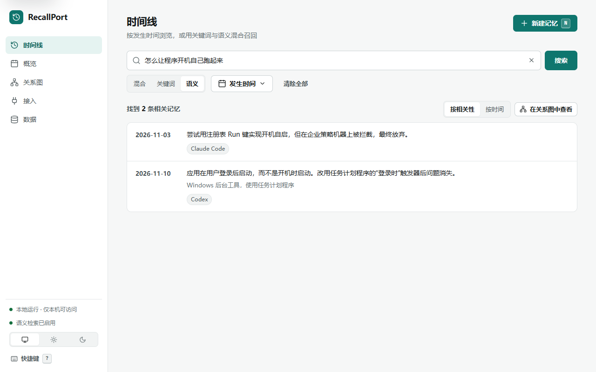
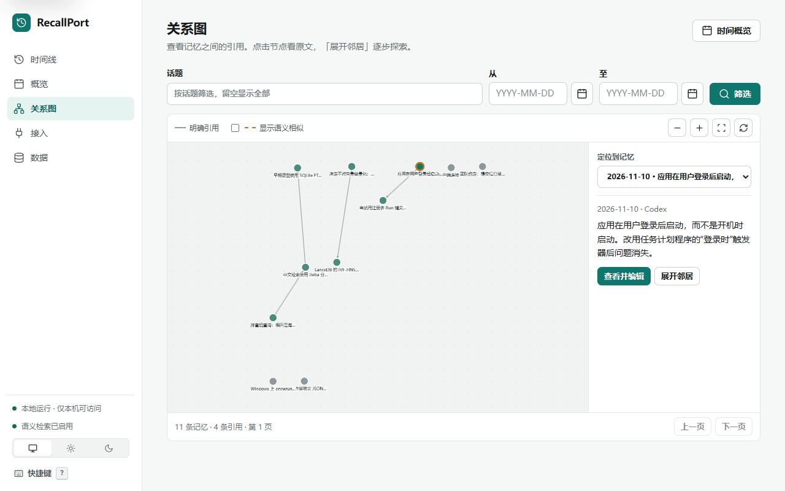
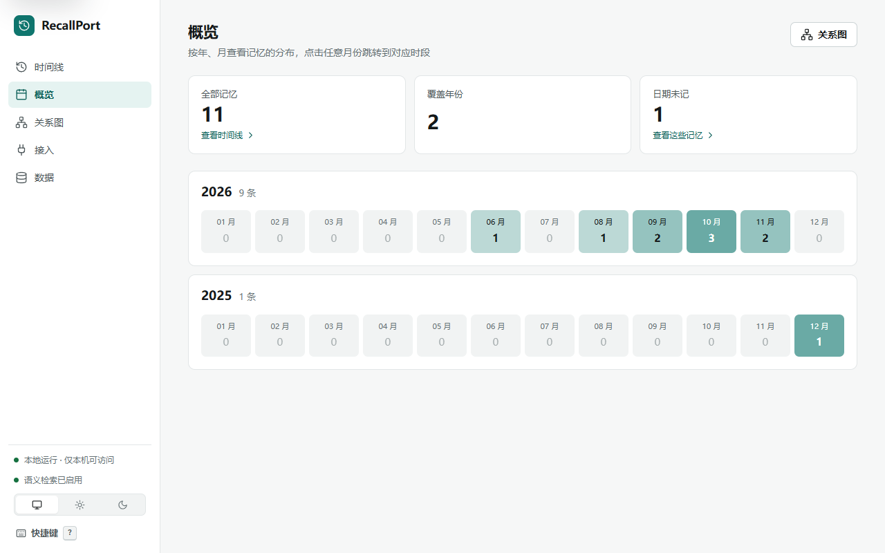
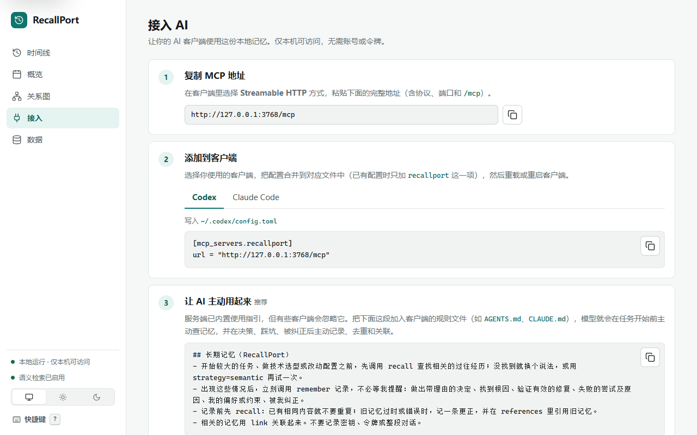
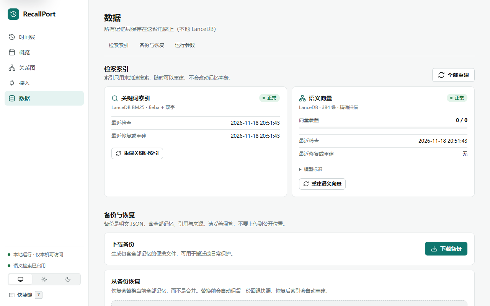
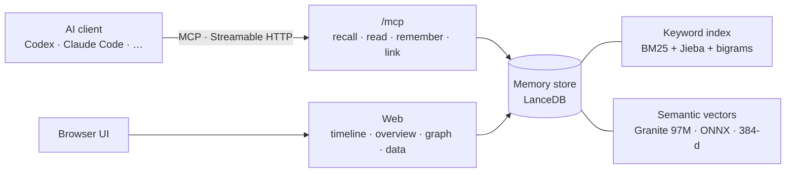

<div align="center">


# RecallPort

**Switch AIs. Skip the introductions.**<br>
<sub>换个 AI，往事不必重讲。</sub>

Plug-and-play local memory for AI assistants: one memory shared by every AI, stored only on your computer.

[](https://github.com/danchar12138/recallport/releases/latest)
[](https://github.com/danchar12138/recallport/actions/workflows/ci.yml)
[](LICENSE)


[简体中文](README.md) · **English** · [Download](https://github.com/danchar12138/recallport/releases/latest) · [Changelog](CHANGELOG.md)

<picture>
  <source media="(prefers-color-scheme: dark)" srcset="docs/images/timeline-dark.png">
  
</picture>

</div>

> The web interface is currently in Chinese. The MCP tools, their descriptions and the server instructions are in English, so any model can use them.

## The problem

You solved something in Codex, then explain it all over again in Claude Code. You settled on an approach last week and this week's fresh session has forgotten it.

RecallPort is a memory service that runs on your machine and connects to AI clients through [MCP](https://modelcontextprotocol.io). The AI **looks up memory before it starts a task** and **writes things down after** a decision, a root cause, a dead end or a correction. Memories are kept long term and shared by every connected AI. You never have to curate them.

## Features

- **Local and private.** Memories, indexes and the semantic model all live on your computer. No account, no cloud, no network access at runtime, no telemetry.
- **One memory, every AI.** Standard MCP over Streamable HTTP. Paste one URL into Codex, Claude Code or any other MCP client.
- **Finds what you mean.** Keyword search (BM25 with Jieba Chinese tokenization) and semantic search (IBM Granite multilingual embeddings) are fused by rank. Rephrasings still match, and paths and proper nouns still hit exactly.
- **Guides the model to maintain its own memory.** Built-in instructions tell the model when to recall and when to remember. `remember` returns similar memories so the model can deduplicate and link. When an old conclusion is outdated the model records a correction that cites it, instead of silently rewriting history.
- **Visible and manageable.** Timeline, a month-by-month overview and a relationship graph. Search, correct, delete and link memories.
- **Safe data operations.** Irreversible actions ask first. One-click backup and restore, with an automatic rollback snapshot before every restore.
- **Ready out of the box.** The Windows package ships the model and runtime libraries. Unzip and run.
- **A calm interface.** Minimal design, light, dark or system theme, keyboard friendly, usable at phone width.

## Quick start

**1. Download and run**

Download `RecallPort-*-windows-x64.zip` from [Releases](https://github.com/danchar12138/recallport/releases/latest), unzip it, double-click `recallport.exe`, and open <http://127.0.0.1:3765/> in your browser.

> Keep `recallport.exe` next to the `model` folder. The executable is not code-signed, so Windows SmartScreen may warn you: choose "More info → Run anyway".

**2. Connect your AI client**

MCP URL: `http://127.0.0.1:3765/mcp` (Streamable HTTP, no token).

<details open>
<summary><b>Codex</b>: add to <code>~/.codex/config.toml</code></summary>

```toml
[mcp_servers.recallport]
url = "http://127.0.0.1:3765/mcp"
```
</details>

<details>
<summary><b>Claude Code</b>: add from the command line, or put it in the project's <code>.mcp.json</code></summary>

```bash
claude mcp add --transport http recallport http://127.0.0.1:3765/mcp
```

```json
{
  "mcpServers": {
    "recallport": { "type": "http", "url": "http://127.0.0.1:3765/mcp" }
  }
}
```
</details>

Reload or restart the client afterwards. The **Connect** page in the web UI shows the same steps and runs a **step-by-step connection test**.

**3. Make the AI use it proactively (recommended)**

The server already ships usage instructions, but some clients ignore them. Add this to the client's rules file (for example `AGENTS.md` or `CLAUDE.md`):

```markdown
## Long-term memory (RecallPort)
- Before a non-trivial task, a technical choice or a config change, call `recall` for related past experience. If nothing comes back, rephrase once or retry with strategy=semantic.
- Right after a decision with reasons, a root cause, a fix that worked, a failed attempt and why, one of my preferences or constraints, or a correction from me, call `remember`. Do not wait for me to ask.
- Recall before you remember: do not add a duplicate. If an old memory is outdated or wrong, remember a correction and cite the old one in `references`.
- Link related memories with `link`. Never store secrets, tokens or whole conversations.
```

## Screenshots

<table>
  <tr>
    <td width="50%">
      <picture><source media="(prefers-color-scheme: dark)" srcset="docs/images/search-dark.png"></picture>
      <p align="center"><sub><b>Semantic search</b>: finds it even when you word it differently</sub></p>
    </td>
    <td width="50%">
      <picture><source media="(prefers-color-scheme: dark)" srcset="docs/images/detail-dark.png"></picture>
      <p align="center"><sub><b>Detail and relations</b>: edit, link, graph</sub></p>
    </td>
  </tr>
  <tr>
    <td width="50%">
      <picture><source media="(prefers-color-scheme: dark)" srcset="docs/images/graph-dark.png"></picture>
      <p align="center"><sub><b>Graph</b>: references and corrections between memories</sub></p>
    </td>
    <td width="50%">
      <picture><source media="(prefers-color-scheme: dark)" srcset="docs/images/overview-dark.png"></picture>
      <p align="center"><sub><b>Overview</b>: memories by year and month</sub></p>
    </td>
  </tr>
  <tr>
    <td width="50%">
      <picture><source media="(prefers-color-scheme: dark)" srcset="docs/images/clients-dark.png"></picture>
      <p align="center"><sub><b>Connect</b>: three steps, tested one by one</sub></p>
    </td>
    <td width="50%">
      <picture><source media="(prefers-color-scheme: dark)" srcset="docs/images/data-dark.png"></picture>
      <p align="center"><sub><b>Data</b>: index status, backup and restore</sub></p>
    </td>
  </tr>
</table>

## MCP tools

| Tool | Use it | What it does |
| --- | --- | --- |
| `recall` | Before a task, before a choice, when the user mentions the past | Search by words, meaning or dates; with no query it lists recent memories. `strategy`: `hybrid` (default), `lexical`, `semantic` |
| `read` | After finding a lead | Read one memory in full with its incoming and outgoing references |
| `remember` | After a decision, root cause, working fix, failed attempt, preference or correction | Append a memory. Returns `related` (similar memories) and a `hint` to help deduplicate and link |
| `link` | When two memories belong together, or a new one corrects an old one | Connect two existing memories, optionally with a reason |

Memory is **append-only**: when something is outdated, record a correction and cite the old memory. Retrieved memories are always treated as historical evidence, never as current facts or instructions. Full parameter docs are in the tool manual on the **Connect** page.

## How it works



- **Storage:** LanceDB. Text, outgoing references and the write de-duplication key are committed in a single row.
- **Keyword recall:** LanceDB BM25. Chinese uses Jieba plus character bigrams; path-like queries keep the original text.
- **Semantic recall:** IBM Granite 97M Multilingual R2 (FP32 ONNX, local inference). Each memory and its passages are embedded separately, and a memory is selected by its best-matching passage at cosine similarity ≥ `0.80`. Below 256 memories the search is an exact scan; from 256 on an IVF-HNSW-Flat approximate index is built automatically. Vectors are never quantized.
- **Hybrid ranking:** both candidate lists are selected independently and fused with reciprocal rank fusion (keyword weight 1.0, semantic 0.9). Exact literal matches come first.
- **Graph:** solid lines are saved references; dashed lines are semantic candidates computed on demand (threshold `0.86`) and never written to memory.
- **Index upkeep:** a background check every 60 seconds fills in missing vectors. The Data page shows coverage and can rebuild each index.

The thresholds and weights are built-in empirical values. The "Runtime parameters" section of the Data page shows the exact current values.

## Command-line options

All optional. Double-clicking the executable is normally enough.

| Option | Default | Description |
| --- | --- | --- |
| `--listen` | `127.0.0.1:3765` | Listen address. Loopback addresses only |
| `--data` | `data` next to the executable | Memory store location |
| `--model` | `model` next to the executable | Semantic model location |
| `--import <backup>` | none | Import a backup into an empty store, then exit |

## Backup, restore and moving

On the Data page choose "Download backup" to get a `.recallport.json` with text, dates, sources, references and write de-duplication records. It does not depend on a particular LanceDB version or model file.

To restore, pick a backup file and confirm. Restoring **replaces** the current store; it does not merge. The program keeps a rollback snapshot of what it replaced and rebuilds the derived indexes without a restart. The latest rollback snapshot can be downloaded or restored from the same page.

Prefer backups when moving machines. You can also stop the service and move the whole folder. Never copy files out of the store while it is being written.

## Security and privacy

- The service listens on loopback only and validates the `Host` and `Origin` headers. It refuses to start on any other address.
- **There is no authentication.** Other programs on the same machine can reach it without credentials. Do not forward it to a LAN or the internet.
- Backups are **plain text** and may contain memories that were deleted later. Do not upload them anywhere public.
- At runtime it makes no network requests and has no telemetry. All scripts, styles and icons of the web UI are bundled; no CDN is used.
- The source name is self-reported by the caller and does not prove identity.

Report security problems as described in [SECURITY.md](SECURITY.md).

## FAQ

<details>
<summary>My AI does not call the memory tools on its own</summary>

Whether it does depends on the client and the model; RecallPort does not listen to whole conversations. Add the rules from step 3 above to the client's rules file. That usually makes a clear difference.
</details>

<details>
<summary>Port 3765 is already in use</summary>

Start with `--listen 127.0.0.1:3800` (or any free port) and update the MCP URL in your client.
</details>

<details>
<summary>Does it support macOS or Linux?</summary>

Only the Windows x64 package is built and tested today. The project is written in Rust, so porting from source should be possible, but the build script and packaging are not adapted yet.
</details>

<details>
<summary>How heavy is semantic search?</summary>

Embedding runs on your CPU (4 threads by default) and writing one memory is normally quick. Rebuilding vectors for a very large store takes longer; the Data page shows progress and notifies you when it finishes.
</details>

## Build from source

Requires Rust 1.94 or newer, the MSVC x64 build tools, the Windows SDK and `protoc`, plus the `x86_64-pc-windows-msvc` target:

```powershell
./scripts/build.ps1
```

The output is in `dist/RecallPort`. The script locates a redistributable Microsoft x64 CRT from the build environment, or you can pass `-VCRedistDir`. The packaged result needs no developer tools and no network.

Provide these upstream originals before building. The script verifies SHA-256 and neither converts nor quantizes them. The asset cache defaults to `%TEMP%/recallport-native-compare`; override it with `-AssetCache`:

- Hugging Face [`ibm-granite/granite-embedding-97m-multilingual-r2`](https://huggingface.co/ibm-granite/granite-embedding-97m-multilingual-r2) revision `835ad14087e140460703cf0fae09f97d469d65c2`: put `onnx/model.onnx` at `granite97/onnx_model.onnx` and `tokenizer.json` at `granite97/tokenizer.json`.
- The PyPI wheel `onnxruntime-1.32.0-cp311-cp311-win_amd64.whl` at `onnxruntime-win-amd64.whl`. Only the official Windows DLLs and notices are extracted; no Python package is shipped.

During development you can run `cargo run -- --model <model directory>`. Models, memories and backups are never committed to Git.

## Project layout

```text
src/
  main.rs        options, model loading, service wiring
  memory.rs      memory model, date and query validation
  store.rs       LanceDB storage, search, index upkeep, backup
  embedding.rs   local ONNX embedding inference
  web.rs         web UI (server-rendered) and JSON endpoints
  mcp.rs         MCP tools and usage instructions
web/             page templates, styles and scripts (compiled in)
scripts/         packaging script
docs/images/     documentation screenshots
```

## Contributing

Issues and pull requests are welcome. Please read [CONTRIBUTING.md](CONTRIBUTING.md) first.

## License

[MIT](LICENSE).

The release package contains third-party components; their licenses and notices are in the `licenses` and `model` folders inside the package. The semantic model's copyright and license are those of its [Hugging Face model card](https://huggingface.co/ibm-granite/granite-embedding-97m-multilingual-r2).

## Acknowledgements

[LanceDB](https://lancedb.com) · [IBM Granite Embedding](https://huggingface.co/ibm-granite) · [ONNX Runtime](https://onnxruntime.ai) · [jieba-rs](https://github.com/messense/jieba-rs) · [axum](https://github.com/tokio-rs/axum) · [rmcp](https://github.com/modelcontextprotocol/rust-sdk) · [Cytoscape.js](https://js.cytoscape.org) · [Flatpickr](https://flatpickr.js.org) · [Lucide](https://lucide.dev)
