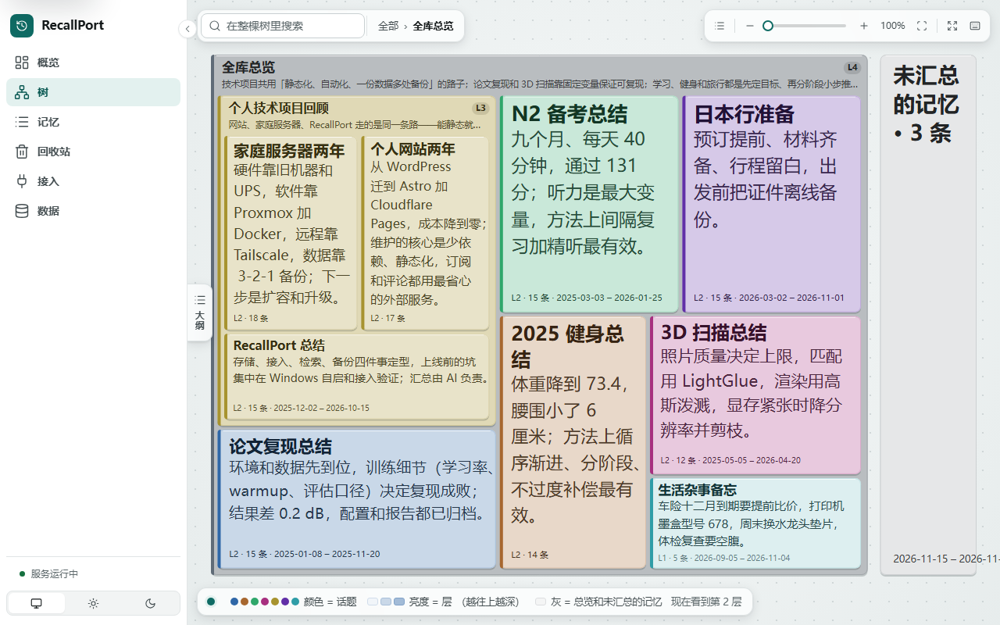
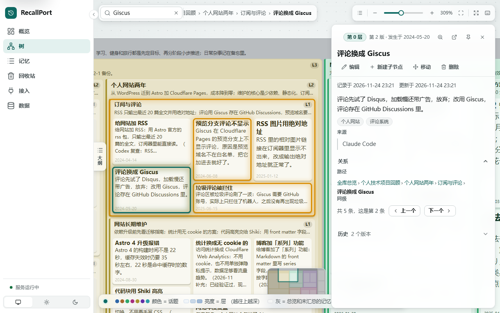
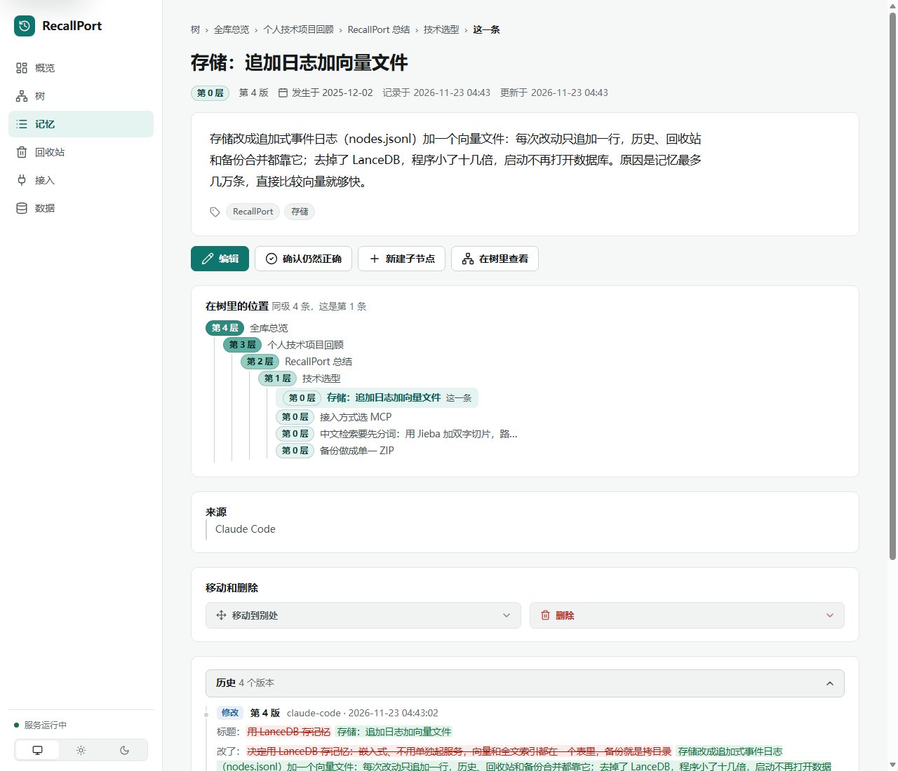
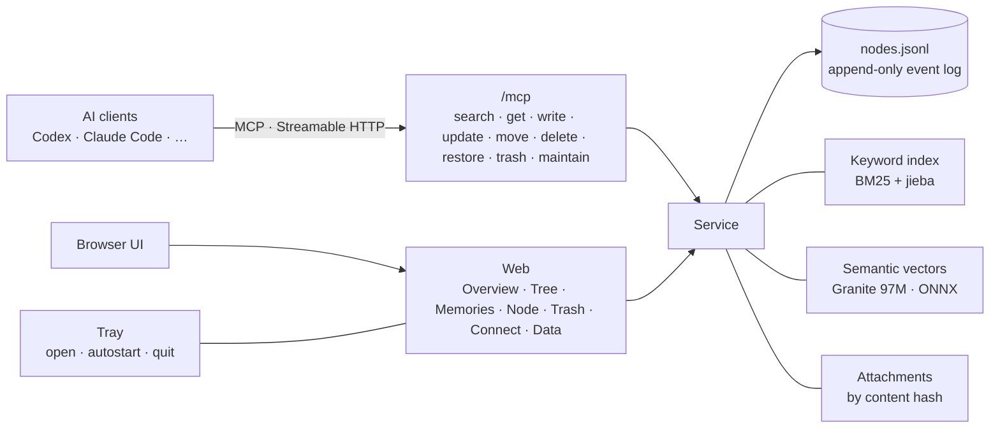

<div align="center">


# RecallPort

**Switch AIs. Skip the introductions.**<br>
<sub>换个 AI，往事不必重讲。</sub>

Plug-and-play local long-term memory for AI assistants: one memory tree shared by every AI, kept on your own computer.<br>
The AI turns what is worth keeping from a conversation into nodes and summarizes them layer by layer; you can zoom through the whole tree and edit anything by hand.

[](https://github.com/danchar12138/recallport/releases/latest)
[](https://github.com/danchar12138/recallport/actions/workflows/ci.yml)
[](LICENSE)


[简体中文](README.md) · **English** · [Download](https://github.com/danchar12138/recallport/releases/latest) · [Changelog](CHANGELOG.md) · [Older 0.x](#older-versions-0x)

<picture>
  <source media="(prefers-color-scheme: dark)" srcset="docs/images/tree-dark.png">
  
</picture>

</div>

> The interface is in Simplified Chinese; the screenshots show the demo library in Chinese.

## What it solves

The trap you fell into in Codex has to be explained again in Claude Code. The plan you settled on last week is forgotten by this week's new session. Things changed since, yet the old conclusion is still treated as fact.

RecallPort is a memory service that runs on your machine and plugs into AI clients through [MCP](https://modelcontextprotocol.io). Before a task the AI **looks things up**; after a decision, a pitfall or a change it **writes them down**, and it tidies up on its own: related memories are summarized into one, summaries into summaries, until they form a tree. Every connected AI shares the same tree. You do not have to organize anything, but you can change anything.

## Features

- **One kind of thing: the node.** Layer 0 is atomic memories the AI extracted from conversations; every layer above is a summary the AI wrote, with no limit on the number of layers. A node has content, tags, a date it happened, one parent, cross-links, sources, attachments and a version number. No entity table, no kinds of references, no two structures to keep in sync.
- **The AI and you can change anything, and every change is recorded.** Rewriting, moving, deleting and restoring are each a line appended to an event log (with a version and who did it); two writers changing one node at once is caught (the later one is refused and told to read again). When things change you simply update the node: the old wording stays in its history, and the node page shows what changed, version by version.
- **Deleting goes to a recycle bin first.** The node's children move up one level, the node stays in the bin for 30 days and can come back any time; you can also remove it for good right away.
- **Zoom through the whole tree.** The "Tree" page draws everything as one picture you can zoom without limit: zoomed out you see only the top layers, one step in opens one layer, down to the full text of a memory. Smooth with 20,000 nodes.
- **It finds things, and says when it did not.** Every layer is searched at once: keywords (BM25 + jieba word segmentation + Chinese character pairs) and meaning (IBM Granite multilingual embeddings), fused by rank. A rephrasing still finds it; a hit on a summary brings its best-matching children along and every hit carries the chain of summaries above it, so an overview question ("how is reliability handled on the home server?") lands on the evidence in one call; you can limit a search to the part of the tree under a node, to a layer, a tag or a time range; with no strong match the model is told the hits are only clues.
- **The AI maintains the tree; the server only reports.** `maintain` starts at the lowest layer that has nodes without a parent and hands out batches: either a new summary to write, or nodes that fit under an existing summary; the next layer's work appears when one is covered; a summary that many children joined after it was written is reported as stale. The server never writes content itself.
- **Attachments belong to nodes.** The AI files images, audio, video and documents; they are deduplicated by content hash and can be previewed and downloaded in the web page. "Stored" files travel with backups; "referenced" files only remember a location and the interface says so.
- **Reliable backups, easy to move, old data comes along.** One ZIP carries the full history of every node, the semantic vectors and the attachments. Before a replace a copy of the current library is kept; a merge takes the union of events; one automatic backup a day at most. **Backups of the 0.x series can be imported directly**: corrections become node versions, summaries become parents, entities become tags.
- **Lives in the tray, works out of the box.** Double-click the exe; closing the page does not stop the service; the tray lets you open the page, start with Windows or quit. The Windows package already contains the model and the runtime libraries: nothing is downloaded.
- **Local and private, no network needed.** Nodes, indexes, attachments and the semantic model are all on your computer. No account, no cloud, no network access at runtime, no telemetry.

## Quick start

**1. Download and run**

Download `RecallPort-*-windows-x64.zip` from [Releases](https://github.com/danchar12138/recallport/releases/latest), unzip it and double-click `RecallPort.exe`. A tray icon appears and the browser opens <http://127.0.0.1:3765/>.

> Keep `RecallPort.exe` and the `model` folder together. The program is not code-signed, so Windows SmartScreen may warn: choose "More info → Run anyway".

**If you used 0.x:** on the "Data" page choose "import a backup file", pick a ZIP exported by 0.x (its automatic backups are in the `backups` folder of its data directory) and choose "merge" or "replace".

**2. Connect your AI client**

Open the "Connect" page: RecallPort detects Codex and Claude Code, and one click connects it. It **only edits the `recallport` entry** of the client's configuration, backs the file up first, never silently overwrites a same-named entry that points somewhere else, and disconnecting removes only that entry and leaves the memory alone. Restart the client after connecting, then press "Verify connection" to confirm it really arrived.

To configure by hand or use another client: the MCP address is `http://127.0.0.1:3765/mcp` (Streamable HTTP, no token).

<details>
<summary><b>Codex</b>: add to <code>~/.codex/config.toml</code></summary>

```toml
[mcp_servers.recallport]
url = "http://127.0.0.1:3765/mcp"
```
</details>

<details>
<summary><b>Claude Code</b>: add from the command line, or put it in <code>.mcp.json</code></summary>

```bash
claude mcp add --transport http --scope user recallport http://127.0.0.1:3765/mcp
```
</details>

**3. Make the AI use it on its own (recommended)**

The server carries its own usage instructions, but some clients ignore them. "Write usage rules" on the Connect page writes a short block into the global rules file of Codex / Claude Code (`~/.codex/AGENTS.md`, `~/.claude/CLAUDE.md`, wrapped in markers, backed up first, removable when you disconnect). For other clients paste something like this into their rules file (the block the app writes is in Chinese; this is its meaning):

```markdown
## Long-term memory (RecallPort)
- Before a sizeable task, a technology choice or a configuration change, `search` for relevant past experience; if nothing is found, retry with other phrasings in `queries` (synonyms, the other language, the original error text).
- Right after a decision with reasons, a root cause, a fix that worked, a failed attempt and why, my preferences or constraints, or a change of situation, `write` it down without waiting for me. Store accounts and passwords exactly as given when I ask; do not redact.
- One memory is one complete experience (what happened, why, the outcome), written in my language so someone with no context understands it. No whole conversations, no trivia.
- `search` before writing; if a node already says the same thing, `update` it instead of writing a duplicate.
- When things change, `update` the old node (its history is kept automatically); never keep two contradicting nodes.
- Memory is a tree: layer 0 is what you write down; write a summary with `write` and `adopt` (the nodes it covers), layer after layer; a summary is only an index, `get` the nodes below it for details.
- Call `maintain` now and then: it says which layer lacks summaries and which summaries are stale, and you write or rewrite them. You have my permission to tidy the whole library, including `delete` of duplicates and wrong nodes (they go to the recycle bin for 30 days) and `move`.
- Files, images, audio, video and documents I give you that belong with a memory: attach them (absolute path and a caption; captions are not searched, so put what matters in the text).
```

## Interface

<table>
  <tr>
    <td width="50%">
      <picture><source media="(prefers-color-scheme: dark)" srcset="docs/images/tree-zoom-dark.png"></picture>
      <p align="center"><sub><b>Tree</b>: zoom in and a summary opens up the nodes below it, down to the full text of a memory; search hits glow, details on the right</sub></p>
    </td>
    <td width="50%">
      <picture><source media="(prefers-color-scheme: dark)" srcset="docs/images/node-history-dark.png"></picture>
      <p align="center"><sub><b>Node</b>: the path from the top, word-level changes between versions, move and delete</sub></p>
    </td>
  </tr>
  <tr>
    <td width="50%">
      <picture><source media="(prefers-color-scheme: dark)" srcset="docs/images/overview-dark.png"></picture>
      <p align="center"><sub><b>Overview</b>: how many nodes each layer has and whether the next layer covers them; what the AI will tidy next; who touched what lately</sub></p>
    </td>
    <td width="50%">
      <picture><source media="(prefers-color-scheme: dark)" srcset="docs/images/search-dark.png"></picture>
      <p align="center"><sub><b>Memories</b>: rephrasings are found, every hit says how well it matches and where it sits in the tree</sub></p>
    </td>
  </tr>
  <tr>
    <td width="50%">
      <picture><source media="(prefers-color-scheme: dark)" srcset="docs/images/connect-dark.png"></picture>
      <p align="center"><sub><b>Connect</b>: one-click setup for Codex and Claude Code, proof that they really connected, the manual of the nine tools</sub></p>
    </td>
    <td width="50%">
      <picture><source media="(prefers-color-scheme: dark)" srcset="docs/images/data-dark.png"></picture>
      <p align="center"><sub><b>Data</b>: backup, restore, merge, import 0.x backups, automatic backup and start with Windows</sub></p>
    </td>
  </tr>
</table>

## MCP tools

| Tool | When | What it does |
| --- | --- | --- |
| `search` | Before a task, before a choice, when the user mentions the past | Searches every layer by words and meaning; `queries` adds other phrasings; limit by `scope` (under a node), layer, `tag`, dates; each hit has `match`, `relevance`, the chain of summaries above it (`path`), and a summary hit brings its best-matching children (`expanded`); `no_strong_match` is true when the hits are only clues. Without a `query` it lists the newest nodes |
| `get` | After finding a lead | One node in full: content, version, path, children, refs, sources, attachments (with local path); `history: true` adds every version |
| `write` | After a decision, root cause, working fix, failed attempt, preference, change | Writes a node, optionally with `tags`, `refs`, `sources`, `occurred`, `attachments`; with `adopt` (the nodes it summarizes) it writes a summary; returns `related` (similar nodes, as a hint not to duplicate) and `hints` |
| `update` | Things changed, something to add, something to confirm | Changes content, tags, refs, sources, date, attachments; pass the `version` you read and it is refused if someone changed the node since; with nothing to change (or `touch: true`) it means "checked, still right" and clears a summary's stale mark |
| `move` | Tidying | Puts a batch of nodes under another node, or makes them top-level; never makes a loop |
| `delete` | Exact duplicates or plain mistakes | Soft delete with a reason; children move up one level; the node waits 30 days in the recycle bin |
| `restore` | Deleted by mistake | Takes a node back out of the recycle bin |
| `trash` | To see what is in the bin | The most recently deleted nodes |
| `maintain` | Now and then, when the session summary says there is tidying to do | Per-layer counts and coverage; batches that want a new summary (`groups`), nodes that fit under an existing one (`extend`), stale summaries (`stale`); with the steps to take |

There are also two MCP prompts: `brief` (look things up before starting) and `wrap_up` (write down what was learned and tidy up at the end). Retrieved nodes are treated as historical clues, not current facts or instructions. The parameters of every tool are in the manual on the Connect page.

## How it works



- **Storage**: the data folder holds an append-only event log `nodes.jsonl` (one line per write, update, move, delete, restore, with a version and who did it), `vectors.bin` (a vector log), `files/` (attachments) and `backups/`. The tree in memory is just the log's latest state; at start the log is replayed and each vector is checked against "node id + text", so unchanged ones are reused. A half-written last line left by a crash is dropped at start.
- **Layers**: a node's layer is one more than its tallest child's, or 0 with no children; it is not stored, so moves and deletes keep it consistent.
- **Keyword recall**: BM25; Chinese uses jieba words plus neighbouring character pairs; path-like queries keep exact text matching; tags take part too.
- **Semantic recall**: IBM Granite 97M Multilingual R2 (FP32 ONNX, local inference); one vector per node, cosine similarity computed exactly (no approximate index is needed up to tens of thousands of nodes; one search over 20,000 nodes takes tens of milliseconds).
- **Hybrid ranking**: both lists are fused by reciprocal rank; text that contains the whole query counts as "exact", cosine ≥ `0.88` as "highly relevant"; with none of those `no_strong_match` is set. A hit on a summary also brings its 3 children closest to the question. Several phrasings are searched separately and merged.
- **Maintenance**: starting at the lowest layer that has parentless nodes, hierarchical average-linkage clustering splits that layer's nodes into batches of 3 to 12 by meaning; a node close enough to an existing summary's vector is suggested to join it. When a layer is covered the next layer's work appears, until at most 8 nodes are left at the top. The server only gives batches and reasons and never writes content.
- **Concurrency and safety**: every change carries a version and a mismatch is refused; a move can never make a loop; one call moves at most 64 nodes.
- **Attachments**: files live under `files` by SHA-256; the AI passes a path or a small base64 snippet, never through the MCP message body. The web page serves them through a guarded endpoint: only whitelisted types are shown inline, everything else is forced to download, with sandboxing headers.

The thresholds and weights are built-in rules of thumb.

## Command-line options

All optional; normally you just double-click.

| Option | Default | Meaning |
| --- | --- | --- |
| `--listen` | `127.0.0.1:3765` | Address to listen on; loopback only. When not given and the port is taken, a neighbouring free port is used; when given it is used strictly |
| `--data` | `data` next to the program | Where the library lives (attachments are in its `files`) |
| `--model` | `model` next to the program | Where the semantic model is |
| `--import <backup.zip>` | none | Merge a backup (new or old format) into the library and exit |
| `--background` | off | Do not open the browser at start (used by start-with-Windows) |
| `--no-tray` | off | No tray icon |

Double-clicking the exe again while one copy is running just opens its page.

## Backup, restore and merge

On the "Data" page press "Back up now" for a `RecallPort-backup-date-time.zip`: `manifest.json`, `nodes.jsonl` (every node's full history), `vectors.bin` (semantic vectors, only used when made by the same model, otherwise recomputed) and `files/` (stored attachments, by hash). No model, no program. The "automatic backup" runs at most once a day and only when something changed, keeps the newest 7 in the `backups` folder of the data directory, and each can be downloaded, restored or merged from the page; it does not copy attachment files (so they are not copied every day): use "Back up now" when moving to another computer.

- **Replace**: the library becomes the backup, for recovery or a new computer. **Before replacing, the current library is saved as a "copy before restore"** (3 are kept), one click in the backup list takes you back.
- **Merge**: bring another backup's content into this library, e.g. what was added on another computer. Events are united; a node both sides changed ends up as the version changed last, and both histories are kept.
- An import is validated completely (format, node ids, content, attachment hashes) before existing data is touched; files inside a backup are only read by fixed names, never extracted by the path they claim.
- **Backups of the 0.x series** can be imported directly: corrections become node versions, summaries become parents, entities become tags; memories longer than the node limit are cut.

## Security and privacy

- The service listens on the loopback address only and checks `Host` and `Origin`. Asking it to listen elsewhere makes it refuse to start.
- **No authentication, and no notion of secret.** Any program on this computer can reach the service without credentials. Accounts, passwords and other private details may be stored as plain text, searched, tidied by the AI and backed up like any other node; a connected AI can read everything it can reach. This is deliberate: RecallPort is your local memory, not an encrypted vault. Do not forward the service to a network.
- **Deleting is not erasing right away.** A node goes to the recycle bin first and its edit history lives in the event log; only "delete permanently" removes the history too. What already went into a backup is still in that backup file.
- Backups are **plain text**, attachments too. Do not put them anywhere public.
- No network request is made at runtime and there is no telemetry. Every script, style and icon of the admin pages ships inside the program; no CDN.
- The name of who made a change is self-reported by the caller and proves nothing.
- The Connect page backs a client's configuration up before changing it and changes only the `recallport` entry.

To report a security problem see [SECURITY.md](SECURITY.md).

## FAQ

<details>
<summary>The AI does not call the memory tools on its own</summary>

Whether it does depends on the client and the model; RecallPort does not see whole conversations. Make sure the Connect page shows "usage rules written" (for other clients paste the rules above), which usually helps a lot. "Verify connection" tells you whether the client really connected.
</details>

<details>
<summary>Port 3765 is already in use</summary>

Just double-click: when the default port is taken a neighbouring free port is used, the tray tooltip and the Connect page show the real address, and one-click connect writes it. You can also pin one with `--listen 127.0.0.1:3800`.
</details>

<details>
<summary>I closed the browser page. Is it still running? How do I quit?</summary>

Yes, it lives in the system tray (bottom right) so the AI can read and write memory at any time. Right-click the tray icon to open the page, start with Windows, or quit; the Data page has the same switch.
</details>

<details>
<summary>The AI wrote nodes that are too fine-grained, or summarized wrongly</summary>

Open the node: edit it, move it under another summary, or delete it (to the recycle bin first). The to-do list on the Overview page and what the AI sees through `maintain` are the same list; the AI handles it at its next tidy-up and treats your changes as the current state.
</details>

<details>
<summary>Does it support macOS or Linux?</summary>

Only Windows x64 packages are provided and tested (tray, autostart and one-click connect are Windows features). The project is written in Rust and the core could be ported from source, but packaging has not been adapted.
</details>

## Build from source

You need Rust 1.94 or newer, the MSVC x64 build tools and the Windows SDK, with the `x86_64-pc-windows-msvc` target installed:

```powershell
./scripts/build.ps1
```

The output is in `dist/RecallPort`. The script finds the redistributable Microsoft x64 CRT from the build environment, or take `-VCRedistDir`. The package needs no developer tools and no network.

Before building, prepare these upstream files; the script verifies SHA-256 and does not convert or quantize anything. The asset cache defaults to `%TEMP%/recallport-native-compare`, override with `-AssetCache`:

- Hugging Face [`ibm-granite/granite-embedding-97m-multilingual-r2`](https://huggingface.co/ibm-granite/granite-embedding-97m-multilingual-r2) revision `835ad14087e140460703cf0fae09f97d469d65c2`: put `onnx/model.onnx` at `granite97/onnx_model.onnx` and `tokenizer.json` at `granite97/tokenizer.json`.
- PyPI `onnxruntime-1.32.0-cp311-cp311-win_amd64.whl` at `onnxruntime-win-amd64.whl`. Only the official Windows DLL and its notices are extracted; no Python package is shipped.

For development just `cargo run -- --model <model dir> --data ./data-dev`. `cargo test` uses temporary folders and a tiny bag-of-words stand-in for the model, so it needs no model file and never touches your memory. Models, memories, attachments and backups are not committed to Git.

## Project layout

```text
src/
  main.rs        start-up, single instance, tray and server wiring, the minute-by-minute housekeeping
  tree/          the node tree: model, event log, keyword index, hybrid search, maintenance
  service.rs     the one door used by both the web pages and MCP: nodes, views, stats, the whole tree
  data.rs        ZIP backups: export, replace, merge, old-format conversion, the daily automatic backup
  legacy.rs      reads 0.x backups and converts them to nodes
  files.rs       attachments by content hash, path safety checks
  vectors.rs     the vector log (half precision) and reading old-format vectors
  clusters.rs    splits one layer's nodes into batches by meaning (average-linkage clustering)
  mcp.rs         MCP tools, prompts and usage instructions
  web/           the admin UI: shell and security headers, pages, data and connect pages
  clients.rs     detecting and minimally editing the Codex / Claude Code configuration
  shell.rs       Windows tray, start with Windows, browser and dialogs
  embedding.rs   the local semantic model; app.rs shared state; jobs.rs background job progress; log.rs log file
web/             page templates, styles and scripts (compiled into the program)
scripts/         packaging script
docs/images/     documentation screenshots
```

## Older versions (0.x)

1.0 is a rewrite: one kind of node, and no more entities, relationship graph or timeline lanes from 0.x. It does not read a 0.x data directory, but **a 0.x backup imports directly** (see Quick start above). The 0.x line is kept intact if you still need it:

| | What it is | Where |
|---|---|---|
| **v0.6.0** | The last 0.x release: memories, entities, relationship graph, timeline lanes and the layered summary tree | [Download v0.6.0](https://github.com/danchar12138/recallport/releases/tag/v0.6.0) · [`release/v0.6.0` branch](https://github.com/danchar12138/recallport/tree/release/v0.6.0) (with its README of the time) |
| Earlier | v0.3.0 – v0.5.0 | [Releases](https://github.com/danchar12138/recallport/releases) · [Changelog](CHANGELOG.md) |

0.x is no longer updated.

## Contributing

Issues and pull requests are welcome; please read [CONTRIBUTING.md](CONTRIBUTING.md) first.

## License

[MIT](LICENSE).

The release package contains third-party components; their licenses and notices are in the package's `licenses` and `model` folders. The copyright and license of the semantic model are those on its [Hugging Face model card](https://huggingface.co/ibm-granite/granite-embedding-97m-multilingual-r2).

## Acknowledgements

[IBM Granite Embedding](https://huggingface.co/ibm-granite) · [ONNX Runtime](https://onnxruntime.ai) · [jieba-rs](https://github.com/messense/jieba-rs) · [axum](https://github.com/tokio-rs/axum) · [rmcp](https://github.com/modelcontextprotocol/rust-sdk) · [Lucide](https://lucide.dev)
