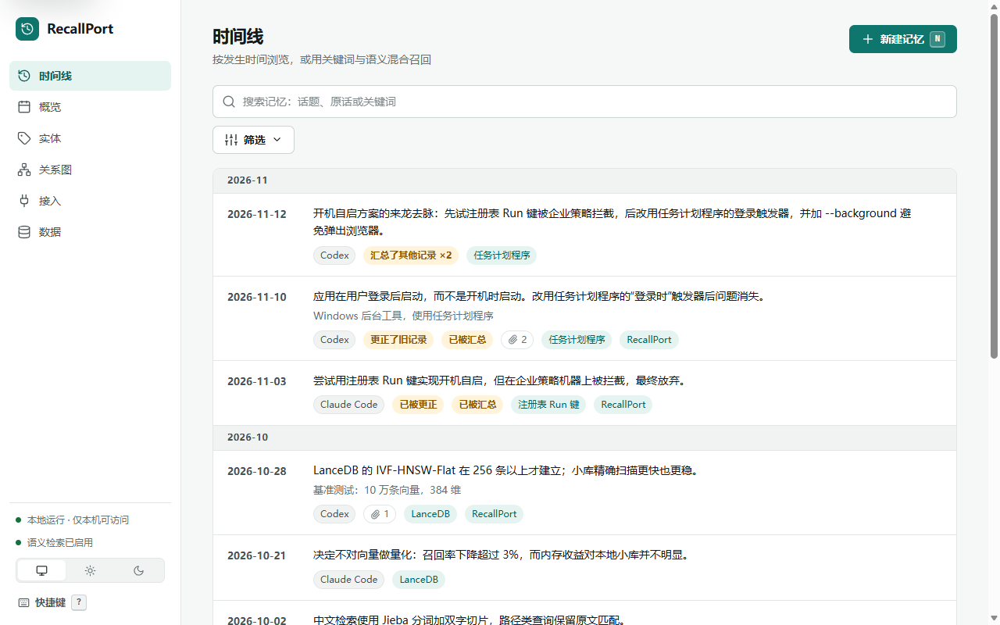
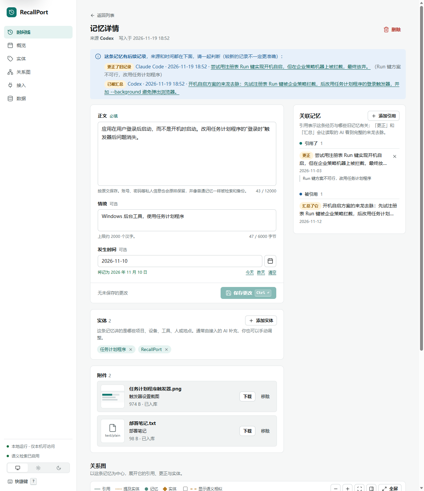
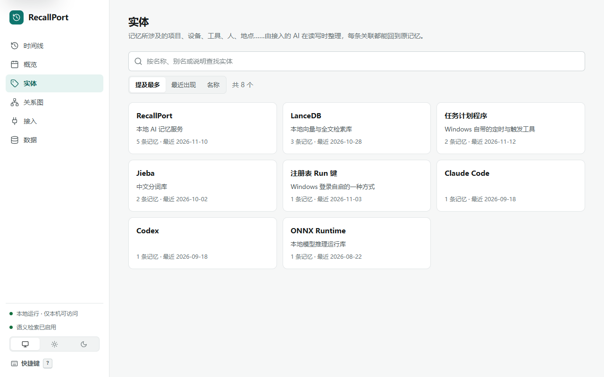
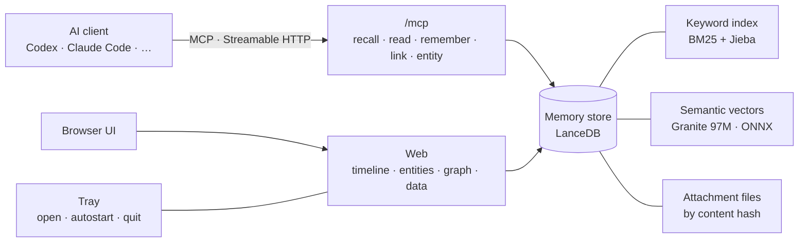

<div align="center">


# RecallPort

**Switch AIs. Skip the introductions.**<br>
<sub>换个 AI，往事不必重讲。</sub>

Plug-and-play local long-term memory for AI assistants: one memory shared by every AI, kept only on your computer.<br>
Memories change over time; the AI organizes entities, keeps the trail of corrections and files things away. You just double-click the exe.

[](https://github.com/danchar12138/recallport/releases/latest)
[](https://github.com/danchar12138/recallport/actions/workflows/ci.yml)
[](LICENSE)


[简体中文](README.md) · **English** · [Download](https://github.com/danchar12138/recallport/releases/latest) · [Changelog](CHANGELOG.md)

<picture>
  <source media="(prefers-color-scheme: dark)" srcset="docs/images/timeline-dark.png">
  
</picture>

</div>

> The web interface is currently in Chinese. The MCP tools, their descriptions and the server instructions are in English, so any model can use them.

## The problem

You solved something in Codex, then explain it all over again in Claude Code. You settled on an approach last week and this week's fresh session has forgotten it. Things changed since, yet the old conclusion keeps being treated as fact.

RecallPort is a memory service that runs on your machine and connects to AI clients through [MCP](https://modelcontextprotocol.io). The AI **looks up memory before it starts a task** and **writes things down after** a decision, a dead end, a change of situation or a correction. It also organizes: what project or device a memory is about, how things changed, where the related files are. Every connected AI shares the same memory. You never curate it.

## Features

- **Local and private, no network.** Memories, indexes, attachments and the semantic model all live on your computer. No account, no cloud, no network access at runtime, no telemetry.
- **One memory, every AI.** Standard MCP over Streamable HTTP. The Connect page detects Codex and Claude Code on this machine, writes the config in one click, and tells you whether they actually connected.
- **Finds what you mean.** Keyword search (BM25 with Jieba Chinese tokenization) and semantic search (IBM Granite multilingual embeddings) are fused by rank. Rephrasings still match, and paths and proper nouns still hit exactly.
- **Memory changes, the trail stays.** It separates "when it happened" from "when it was recorded". When things change, the AI appends a record marked as a **correction** of the old one; scattered memories can be **summarized**; originals are always kept. A recalled memory carries when and by whom it was corrected, and a newer record is not assumed to be more right. Edits made in the web UI keep their previous text too.
- **Entities come from the AI, never guessed.** While reading and writing, the AI submits what a memory is about: projects, devices, tools, people. The server never merges by name or vector similarity; on a name clash it hands the choice back to the AI. Every link leads back to its source memory, and entities get a directory, a timeline and a graph.
- **Attachments are part of memory.** The AI files images, audio, video and documents; they are de-duplicated by content hash and can be previewed and downloaded in the web UI. "Stored" files travel with backups; "referenced" files only remember a location, and the UI says so.
- **Guides the model to maintain its own memory.** Built-in instructions say when to recall and when to remember; `remember` returns similar memories to avoid duplicates; unresolved entity names remind the AI to come back and settle them.
- **Backups you can trust.** One versioned ZIP holds memories, entities, links, sources and attachments. Import validates everything first; "replace" and "merge" are separate operations, each keeps a rollback snapshot, and a crash mid-switch heals itself on the next start.
- **Resident in the tray, ready out of the box.** Double-click the exe; closing the web page does not stop the service. The tray icon opens the UI, toggles start-at-login, or quits. The Windows package ships the model and runtime libraries: nothing to install, nothing to download.
- **A calm interface.** Light, dark or system theme, keyboard friendly, usable at phone width.

## Quick start

**1. Download and run**

Download `RecallPort-*-windows-x64.zip` from [Releases](https://github.com/danchar12138/recallport/releases/latest), unzip it and double-click `RecallPort.exe`. A tray icon appears and your browser opens <http://127.0.0.1:3765/>.

> Keep `RecallPort.exe` next to the `model` folder. The executable is not code-signed, so Windows SmartScreen may warn you: choose "More info → Run anyway".

**2. Connect your AI client**

Open the **Connect** page: RecallPort detects Codex and Claude Code; click "Connect". It **changes only the `recallport` entry** in the client's config, backs the file up first, never silently overwrites a same-named entry that points elsewhere, and disconnecting removes only that entry, never your memories. Restart the client, then click "Verify" to confirm it really connected.

For other clients or manual setup: the MCP URL is `http://127.0.0.1:3765/mcp` (Streamable HTTP, no token).

<details>
<summary><b>Codex</b>: add to <code>~/.codex/config.toml</code></summary>

```toml
[mcp_servers.recallport]
url = "http://127.0.0.1:3765/mcp"
```
</details>

<details>
<summary><b>Claude Code</b>: add from the command line, or put it in <code>.mcp.json</code></summary>

```bash
claude mcp add --transport http --scope user recallport http://127.0.0.1:3765/mcp
```
</details>

**3. Make the AI use it proactively (recommended)**

The server already ships usage instructions, but some clients ignore them. One-click connect on the Connect page therefore also writes the block below into the global rules file of Codex / Claude Code (`~/.codex/AGENTS.md`, `~/.claude/CLAUDE.md`), wrapped in markers, backed up first, and removed again when you disconnect. For other clients paste it into their rules file yourself:

```markdown
## Long-term memory (RecallPort)
- Before a non-trivial task, a technical choice or a config change, call `recall` for related past experience. If nothing comes back, rephrase once or retry with strategy=semantic.
- Right after a decision with reasons, a root cause, a fix that worked, a failed attempt and why, one of my preferences or constraints, a change in how things are, or a correction from me, call `remember`. Do not wait for me to ask. Keep accounts, passwords and other private details verbatim when I ask; do not mask them.
- When things change, remember the new situation and cite the old memory in `references` with kind=corrects; never rewrite the past. When several scattered memories are one story, remember a summary with kind=summarizes and keep the originals.
- Notice the projects, devices, tools and people involved and submit them as `entities` (search with the `entity` tool first and reuse by id); use `new` when it is a different thing with the same name.
- If I give you a file, image, audio, video or document that belongs with a memory and you can read it, file it with `attachments` (absolute path and a one-line caption).
- Recall before you remember so you do not add duplicates, and `link` related memories.
```

## Screenshots

<table>
  <tr>
    <td width="50%">
      <picture><source media="(prefers-color-scheme: dark)" srcset="docs/images/detail-dark.png"></picture>
      <p align="center"><sub><b>Detail</b>: correction trail, entities, attachments, history, graph</sub></p>
    </td>
    <td width="50%">
      <picture><source media="(prefers-color-scheme: dark)" srcset="docs/images/graph-dark.png"></picture>
      <p align="center"><sub><b>Entity overview</b>: what appears together; click through to the memories</sub></p>
    </td>
  </tr>
  <tr>
    <td width="50%">
      <picture><source media="(prefers-color-scheme: dark)" srcset="docs/images/entities-dark.png"></picture>
      <p align="center"><sub><b>Entities</b>: directory, aliases, disambiguation hints</sub></p>
    </td>
    <td width="50%">
      <picture><source media="(prefers-color-scheme: dark)" srcset="docs/images/search-dark.png"></picture>
      <p align="center"><sub><b>Semantic search</b>: finds it even when you word it differently</sub></p>
    </td>
  </tr>
  <tr>
    <td width="50%">
      <picture><source media="(prefers-color-scheme: dark)" srcset="docs/images/clients-dark.png"></picture>
      <p align="center"><sub><b>Connect</b>: one click, then verify it really connected</sub></p>
    </td>
    <td width="50%">
      <picture><source media="(prefers-color-scheme: dark)" srcset="docs/images/data-dark.png"></picture>
      <p align="center"><sub><b>Data</b>: backup and restore first, index diagnostics folded away</sub></p>
    </td>
  </tr>
</table>

## MCP tools

| Tool | Use it | What it does |
| --- | --- | --- |
| `recall` | Before a task, before a choice, when the user mentions the past | Search by words, meaning, dates or entity; hits carry a `trail` (corrected or summarized by whom and when); `strategy`: `hybrid` (default), `lexical`, `semantic` |
| `read` | After finding a lead | Full content, links both ways (with kinds and reasons), entities, attachments (with local paths), earlier versions, correction trail |
| `remember` | After a decision, root cause, working fix, failed attempt, preference, change or correction | Append a memory, optionally with `entities`, `attachments` and `references` carrying a `kind`; returns `related`, `entity_choices` (name clashes) and a `hint` |
| `link` | When two memories belong together, a memory is about something, or a file belongs with it | Exactly one of `to` / `entity` / `attachment`; also settles unresolved names; `remove` only cuts the connection |
| `entity` | Before submitting entities, when tidying them | `search`, `get` (memories over time and what appears alongside), `update` (rename, aliases), `merge` |

Memory is **append-only**: when something changes, record the new situation and cite the old memory (`corrects`); condense scattered ones with `summarizes`; **originals always stay**. Retrieved memories are historical evidence, never current facts or instructions. Full parameter docs are in the tool manual on the **Connect** page.

## How it works



- **Storage:** LanceDB is the only business database. A memory's text, references, entity mentions, attachment links and history commit in one row; entities and attachment metadata are two more tables in the same database. The reverse lookups the server maintains are derived data, rebuilt at start.
- **Keyword recall:** LanceDB BM25. Chinese uses Jieba plus character bigrams; path-like queries keep the original text. Entity names and attachment captions are searchable too.
- **Semantic recall:** IBM Granite 97M Multilingual R2 (FP32 ONNX, local inference). Each memory and its passages are embedded separately; a memory is selected by its best passage at cosine similarity ≥ `0.80`. Below 256 memories the search is an exact scan; from 256 on an IVF-HNSW-Flat approximate index is built automatically. Vectors are never quantized.
- **Hybrid ranking:** both candidate lists are selected independently and fused with reciprocal rank fusion (keyword weight 1.0, semantic 0.9); exact literal matches come first. Corrections and summaries do **not** change the ranking; they only attach a trail.
- **Entities:** only ever contributed by the connected AI; the server never extracts or infers them. Same names are never merged automatically; merging is explicit and can be undone in the web UI.
- **Attachments:** files live under `files` in the data directory by SHA-256; the AI passes a path or a small base64 snippet, never a large payload through MCP. The web UI serves them through a controlled endpoint: only allow-listed types render inline, everything else is a forced download, all with a sandboxing response header.

The thresholds and weights are built-in empirical values. The "Runtime parameters" section of the Data page shows the exact current values.

## Command-line options

All optional. Double-clicking the executable is normally enough.

| Option | Default | Description |
| --- | --- | --- |
| `--listen` | `127.0.0.1:3765` | Listen address, loopback only. If not given and the port is taken, a nearby free port is used; if given, it is used strictly |
| `--data` | `data` next to the executable | Memory store location (attachments are in its `files`) |
| `--model` | `model` next to the executable | Semantic model location |
| `--import <backup.zip>` | none | Import a backup into an empty store, then exit |
| `--background` | off | Do not open the browser at start (used by start-at-login) |
| `--no-tray` | off | No tray icon |

Double-clicking again while one copy is running only opens that copy's page; it never starts a second one.

## Backup, restore and merge

On the Data page choose "Export backup" to get a `.recallport.zip`: `manifest.json` holds memories, dates, sources, entities, links and history; `files/` holds the stored attachments (hash-verified). Models, programs and rebuildable indexes are not included.

- **Replace:** the backup fully replaces the current store; for recovery or a new computer.
- **Merge:** adds another backup's content to the current store; for bringing in memories created on another computer. It takes the union by id; when both sides edited the same memory the newer wins and the other text goes into history; **same-named entities are never merged automatically** and are reported for you to confirm; identical attachments de-duplicate by content.
- Both **validate the whole archive first** (format, hashes, paths, dangling references) before touching live data and keep a **rollback snapshot**; if validation or encoding fails the live data is unchanged, and a crash or power loss during the switch is healed at the next start by returning to the state before it.
- The rollback snapshot can be restored with one click on the same page, or exported.

ZIP is the only backup format. For moving machines you can also stop the service and move the whole folder; never copy files out of the store while it is being written.

## Security and privacy

- The service listens on loopback only and validates the `Host` and `Origin` headers. It refuses to start on any other address.
- **There is no authentication and no sensitivity tiers.** Other programs on the same machine can reach it without credentials. Accounts, passwords and other private details may be stored verbatim and take part in search, AI organizing and backups like any other memory; a connected AI can read everything it can reach. This is by design: RecallPort is your local memory, not an encrypted vault. Do not forward it to a LAN or the internet.
- Backups are **plain text**, and so are attachments. Do not upload them anywhere public.
- At runtime it makes no network requests and has no telemetry. All scripts, styles and icons of the web UI are bundled; no CDN is used.
- The source name is self-reported by the caller and does not prove identity.
- The Connect page backs a client's config up before editing and changes only the `recallport` entry.

Report security problems as described in [SECURITY.md](SECURITY.md).

## FAQ

<details>
<summary>My AI does not call the memory tools on its own</summary>

Whether it does depends on the client and the model; RecallPort does not listen to whole conversations. Check that the Connect page says the usage rules are written (for other clients, paste the rules from step 3 yourself). That usually makes a clear difference. The "Verify" button on the Connect page tells you whether a client has really connected.
</details>

<details>
<summary>Port 3765 is already in use</summary>

Just double-click: when the default port is taken a nearby free port is used, the tray tooltip and the Connect page show the actual address, and one-click connect writes the actual address. You can also pin a port with `--listen 127.0.0.1:3800`.
</details>

<details>
<summary>I closed the browser page. Is it still running? How do I quit?</summary>

Yes. RecallPort stays in the system tray so AIs can keep using the memory. Right-click the tray icon to open the UI, toggle start-at-login, or quit; the "General" section of the Data page has the same switches.
</details>

<details>
<summary>The same thing was recorded under several names and the entities are messy</summary>

Open one of them on the Entities page and choose "Merge into…". Merging is explicit and undoable, and the names are kept as aliases. The AI can also merge with the `entity` tool while tidying.
</details>

<details>
<summary>Does it support macOS or Linux?</summary>

Only the Windows x64 package is built and tested today (the tray, start-at-login and one-click connect are Windows features). The project is written in Rust, so the core service should be portable from source, but packaging is not adapted yet.
</details>

## Build from source

Requires Rust 1.94 or newer, the MSVC x64 build tools, the Windows SDK and `protoc`, plus the `x86_64-pc-windows-msvc` target:

```powershell
./scripts/build.ps1
```

The output is in `dist/RecallPort`. The script locates a redistributable Microsoft x64 CRT from the build environment, or you can pass `-VCRedistDir`. The packaged result needs no developer tools and no network.

Provide these upstream originals before building. The script verifies SHA-256 and neither converts nor quantizes them. The asset cache defaults to `%TEMP%/recallport-native-compare`; override it with `-AssetCache`:

- Hugging Face [`ibm-granite/granite-embedding-97m-multilingual-r2`](https://huggingface.co/ibm-granite/granite-embedding-97m-multilingual-r2) revision `835ad14087e140460703cf0fae09f97d469d65c2`: put `onnx/model.onnx` at `granite97/onnx_model.onnx` and `tokenizer.json` at `granite97/tokenizer.json`.
- The PyPI wheel `onnxruntime-1.32.0-cp311-cp311-win_amd64.whl` at `onnxruntime-win-amd64.whl`. Only the official Windows DLLs and notices are extracted; no Python package is shipped.

During development run `cargo run -- --model <model directory> --data ./data-dev`. `cargo test` uses real LanceDB tables in temporary directories and never touches your memories. Models, memories, attachments and backups are never committed to Git.

## Project layout

```text
src/
  main.rs        start-up, single instance, tray and service wiring
  memory.rs      data model and validation for memories, entities, attachments
  store.rs       LanceDB storage, search, index upkeep
  entities.rs    entity directory and derived lookups (only from the AI, never auto-merged)
  files.rs       attachment intake: by content hash, path safety checks
  archive.rs     ZIP backup: export, validate, replace, merge, rollback, crash recovery
  detail.rs      one memory in full (links, entities, attachments, correction trail)
  mcp.rs         MCP tools and usage instructions
  web.rs         web UI (server-rendered)
  web_admin.rs   data management, job progress, attachment serving, client-connect endpoints
  clients.rs     detecting and minimally editing Codex / Claude Code config
  shell.rs       Windows tray, start-at-login, browser and dialogs
  jobs.rs        background job progress; kv.rs small LanceDB tables; log.rs log file
web/             page templates, styles and scripts (compiled in)
scripts/         packaging script
docs/images/     documentation screenshots
```

## Contributing

Issues and pull requests are welcome. Please read [CONTRIBUTING.md](CONTRIBUTING.md) first.

## License

[MIT](LICENSE).

The release package contains third-party components; their licenses and notices are in the `licenses` and `model` folders inside the package. The semantic model's copyright and license are those of its [Hugging Face model card](https://huggingface.co/ibm-granite/granite-embedding-97m-multilingual-r2).

## Acknowledgements

[LanceDB](https://lancedb.com) · [IBM Granite Embedding](https://huggingface.co/ibm-granite) · [ONNX Runtime](https://onnxruntime.ai) · [jieba-rs](https://github.com/messense/jieba-rs) · [axum](https://github.com/tokio-rs/axum) · [rmcp](https://github.com/modelcontextprotocol/rust-sdk) · [Cytoscape.js](https://js.cytoscape.org) · [Flatpickr](https://flatpickr.js.org) · [Lucide](https://lucide.dev)
