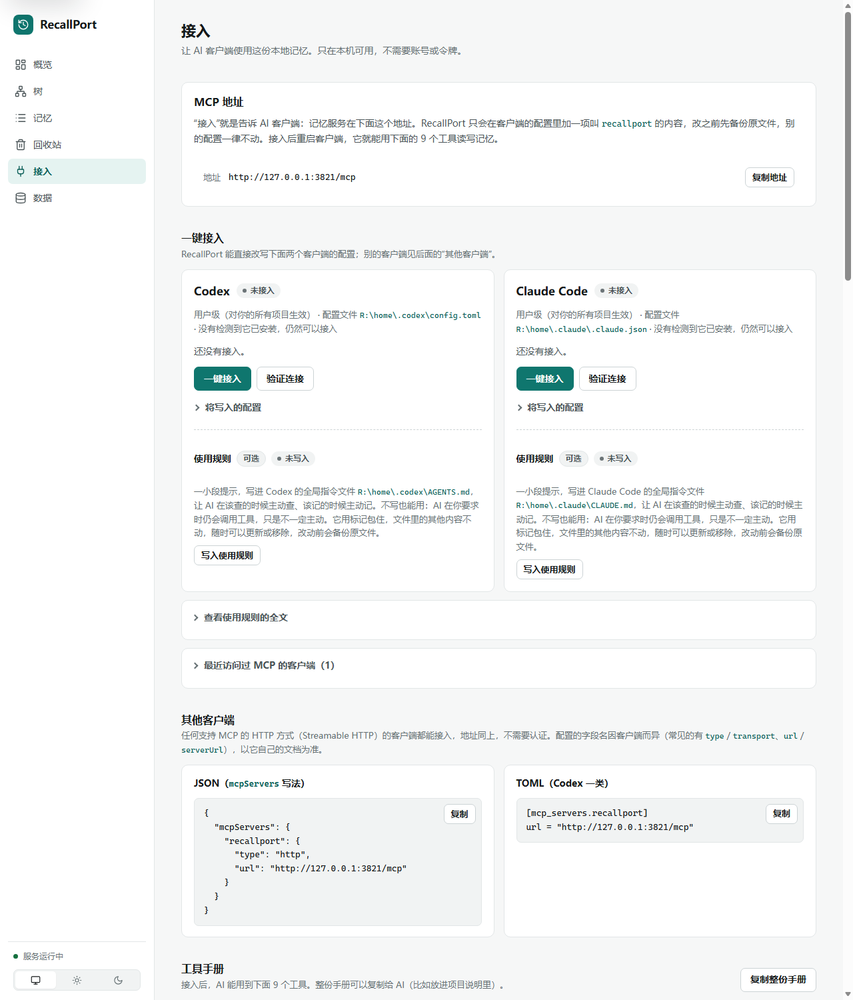
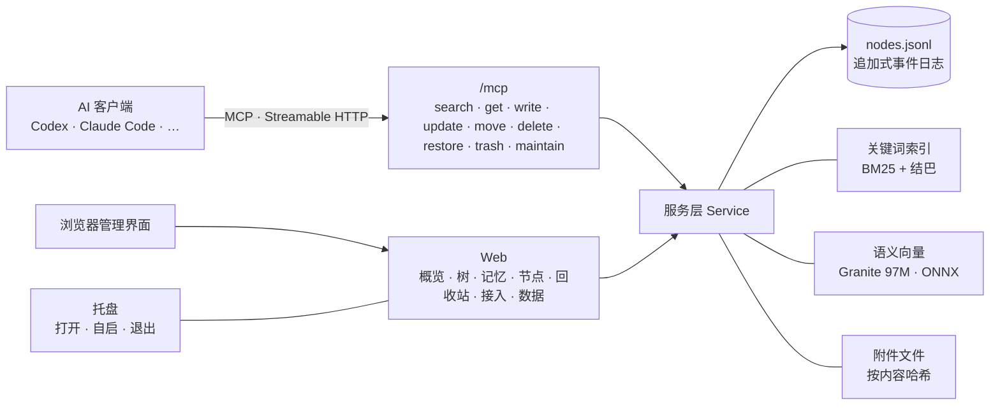

<div align="center">


# RecallPort

**换个 AI，往事不必重讲。**<br>
<sub>Switch AIs. Skip the introductions.</sub>

即插即用的本地 AI 长期记忆：一棵记忆树，所有 AI 共享，数据只在你的电脑上。<br>
AI 把对话里值得留下的东西记成节点，再一层层汇总上去；你可以缩放着看整棵树，也可以随手改。

[](https://github.com/danchar12138/recallport/releases/latest)
[](https://github.com/danchar12138/recallport/actions/workflows/ci.yml)
[](LICENSE)


**简体中文** · [English](README.en.md) · [下载](https://github.com/danchar12138/recallport/releases/latest) · [更新日志](CHANGELOG.md)

<picture>
  <source media="(prefers-color-scheme: dark)" srcset="docs/images/tree-dark.png">
  
</picture>

</div>

## 它解决什么问题

你在 Codex 里踩过的坑，换到 Claude Code 又要从头讲一遍；上周定下的方案，这周的新会话已经忘了；后来情况变了，旧结论却还在被当成事实。

RecallPort 是一个跑在本机的记忆服务，通过 [MCP](https://modelcontextprotocol.io) 接入各种 AI 客户端。AI 在任务开始前**主动查记忆**，在决策、踩坑、情况变化之后**主动记下来**，并且自己整理：相近的记忆汇总成一条，汇总再汇总，收成一棵树。所有接入的 AI 共享同一棵树。你不用手动整理，但想改哪里都可以改。

## 特性

- **只有一种东西：节点。** 第 0 层是 AI 从对话里提取的原子记忆；往上每一层是 AI 写的汇总，层数不限。一个节点有内容、标签、发生时间、一个父节点、跨树的引用、来源、附件和版本号。没有实体表，没有引用种类，没有两套结构要同步。
- **AI 和你都能随意改，每次改动都留痕。** 改写、移动、删除、恢复，都是追加到事件日志里的一条（带版本和操作者）；两个人同时改一个节点，后到的会被拒绝并提示重新读取。情况变了就直接更新那个节点，旧文字留在它的历史里，节点页上能看到逐版的改动。
- **删除先进回收站。** 节点的孩子上移一层，回收站里留 30 天，随时恢复；也可以立刻永久清除。
- **缩放着看整棵树。** 「树」页把整棵树画成一幅可以无级缩放的图：缩小只看最上面几层，放大一步展开一层，一直到记忆本身的全文。两万个节点也流畅。
- **找得到，也会说「没找到」。** 所有层一起搜：关键词（BM25 + 结巴分词 + 中文双字）与语义（IBM Granite 多语言向量）按名次融合。换种说法也能找到；命中汇总时直接带上最贴近问题的子节点，每条命中带着它头顶的汇总链，所以「家庭服务器的可靠性怎么做的」这类概览问题一次就落到证据上；可以限定在某个节点之下、某一层、某个标签或某段时间；没有强匹配时明确告诉模型「只是线索」。
- **AI 维护整棵树，服务端只报告。** `maintain` 从最底下还没被汇总的那一层开始，按批给出该新写的汇总，或该并进已有汇总的节点；收完一层才出现上一层的活；孩子后来才并进来太多的汇总会报「过期」。服务端从不替 AI 写内容。
- **附件是节点的一部分。** AI 把图片、音视频、文档归档进来，按内容哈希去重，可在网页预览和下载。「已入库」随备份带走；「仅引用」只记录位置，界面会明确标注。
- **备份可靠，换机省心，老数据能进来。** 一个 ZIP 带走节点的全部历史、语义向量和附件。「替换」前自动留一份副本，「合并」按事件取并集；每天最多自动备份一次。**0.x 版本的备份可以直接导入**：更正变成节点的版本，汇总变成父节点，实体变成标签。
- **常驻托盘，开箱即用。** 双击 exe 即可，关闭网页不会停止服务；托盘里可以打开、设为登录时自动启动、退出。Windows 免安装包已内置模型和运行库，不需要联网下载任何东西。
- **本地私有，无需联网。** 节点、索引、附件和语义模型都在你的电脑上。没有账号，没有云端，运行时不联网，也没有遥测。

## 快速开始

**1. 下载并运行**

从 [Releases](https://github.com/danchar12138/recallport/releases/latest) 下载 `RecallPort-*-windows-x64.zip`，解压后双击 `RecallPort.exe`。托盘出现图标，浏览器自动打开 <http://127.0.0.1:3765/>。

> 请保持 `RecallPort.exe` 与 `model` 文件夹在一起。程序未做代码签名，Windows SmartScreen 可能提示，点“更多信息 → 仍要运行”即可。

**如果你用过 0.x：** 在网页「数据」页选“导入备份文件”，选 0.x 导出的 ZIP（旧版的自动备份在它的数据目录的 `backups` 文件夹里），再选“合并进来”或“替换”。

**2. 接入你的 AI 客户端**

打开网页的「接入」页：RecallPort 会检测 Codex 和 Claude Code，点「一键接入」即可。它**只修改客户端配置里的 `recallport` 这一项**，改之前先备份原文件，已有同名但指向别处的配置不会被悄悄覆盖，断开也只移除这一项、不动记忆。接入后重启客户端，再点「验证连接」确认它真的连上了。

想手动配置，或使用其他客户端：MCP 地址是 `http://127.0.0.1:3765/mcp`（Streamable HTTP，无需令牌）。

<details>
<summary><b>Codex</b>：写入 <code>~/.codex/config.toml</code></summary>

```toml
[mcp_servers.recallport]
url = "http://127.0.0.1:3765/mcp"
```
</details>

<details>
<summary><b>Claude Code</b>：命令行添加，或写入 <code>.mcp.json</code></summary>

```bash
claude mcp add --transport http --scope user recallport http://127.0.0.1:3765/mcp
```
</details>

**3. 让 AI 主动用起来（推荐）**

服务端已内置使用指引，但有些客户端会忽略它。「接入」页的“写入使用规则”会把下面这段写进 Codex / Claude Code 的全局规则文件（`~/.codex/AGENTS.md`、`~/.claude/CLAUDE.md`，用标记包住，改前备份，断开时可以一并移除）。其他客户端请自己粘贴到它的规则文件里：

```markdown
## 长期记忆（RecallPort）
- 开始较大的任务、做技术选型或改动配置之前，先调用 search 查找相关的过往经历；没找到就在 queries 里换几种说法（同义词、另一种语言、原始报错）再试一次。
- 做出带理由的决定、找到根因、验证有效的修复、失败的尝试及原因、我的偏好或约束、情况发生变化之后，立刻调用 write 记录，不必等我提醒。账号、密码等私人信息按我的要求原文保存，不要打码。
- 一条记忆只写一段完整的经历（发生了什么、为什么、结果），用我的语言写，让没有上下文的人也能看懂；不要存整段对话和琐事。
- 记录前先 search；已经有节点说了同一件事，就用 update 改它，不要重复写。
- 情况变了，就用 update 改写那条旧节点，历史会自动保留；不要让两条互相矛盾的节点同时存在。
- 记忆是一棵树：第 0 层是你记下的原子记忆，汇总用 write 并在 adopt 里填它所概括的节点，一层层往上；汇总只是索引，细节要用 get 看下面的节点。
- 时不时调用 maintain：它会告诉你哪一层缺汇总、哪条汇总已经过期，由你补写或改写；我已授权你整理整个记忆库，包括用 delete 删除重复和错误的节点（会进回收站，30 天内可恢复），也可以用 move 调整位置。
- 我给你的文件、图片、音视频、文档，如果和某条记忆相关且你能读取，就用 attachments 归档（给绝对路径和一句说明，说明不会被搜索，重要的信息写进正文）。
```

## 界面一览

<table>
  <tr>
    <td width="50%">
      <picture><source media="(prefers-color-scheme: dark)" srcset="docs/images/tree-zoom-dark.png"></picture>
      <p align="center"><sub><b>树</b>：放大进去，汇总里一层层露出下面的节点，直到记忆本身的全文；搜索命中的节点发光，右边是它的详情</sub></p>
    </td>
    <td width="50%">
      <picture><source media="(prefers-color-scheme: dark)" srcset="docs/images/node-history-dark.png"></picture>
      <p align="center"><sub><b>节点</b>：从最上层一路下来的路径、历史版本里逐字的改动、移动与删除</sub></p>
    </td>
  </tr>
  <tr>
    <td width="50%">
      <picture><source media="(prefers-color-scheme: dark)" srcset="docs/images/overview-dark.png"></picture>
      <p align="center"><sub><b>概览</b>：每一层有多少条、是否都被上一层汇总；AI 下次要整理的事；最近谁动了哪一条</sub></p>
    </td>
    <td width="50%">
      <picture><source media="(prefers-color-scheme: dark)" srcset="docs/images/search-dark.png"></picture>
      <p align="center"><sub><b>记忆</b>：换种说法也能找到，每条标明匹配程度和它在树里的位置</sub></p>
    </td>
  </tr>
  <tr>
    <td width="50%">
      <picture><source media="(prefers-color-scheme: dark)" srcset="docs/images/connect-dark.png"></picture>
      <p align="center"><sub><b>接入</b>：一键接入 Codex 和 Claude Code、验证真的连上了、九个工具的手册</sub></p>
    </td>
    <td width="50%">
      <picture><source media="(prefers-color-scheme: dark)" srcset="docs/images/data-dark.png"></picture>
      <p align="center"><sub><b>数据</b>：备份、恢复、合并、导入旧版备份，自动备份和开机自启</sub></p>
    </td>
  </tr>
</table>

## MCP 工具

| 工具 | 何时使用 | 说明 |
| --- | --- | --- |
| `search` | 任务开始前、做选择前、用户提到过去时 | 所有层一起按关键词和含义找；`queries` 一次带上多种说法；可限定 `scope`（某个节点之下）、层、`tag`、日期；命中项带 `match`、`relevance`、头顶的汇总链 `path`，汇总命中还带最贴近问题的子节点 `expanded`；没有强匹配时 `no_strong_match` 为 true。不给 `query` 就列出最新的节点 |
| `get` | 找到线索后 | 一个节点的完整内容、版本号、路径、孩子、引用、来源、附件（含本机路径）；`history: true` 带上所有历史版本 |
| `write` | 决策、根因、有效修复、失败尝试、偏好、变化之后 | 写一个节点，可带 `tags`、`refs`、`sources`、`occurred`、`attachments`；带 `adopt`（它概括的节点）就是写一条汇总；返回 `related`（相似的节点，提示别重复）和 `hints` |
| `update` | 情况变了、要补充、要确认 | 改内容、标签、引用、来源、日期、附件；带上读到的 `version`，别人先改过会被拒绝；什么都不改（或 `touch: true`）就是“确认这个节点仍然正确”，会清除汇总的过期标记 |
| `move` | 整理时 | 把一批节点放到另一个节点之下，或设为顶层；不会成环 |
| `delete` | 整理时遇到完全重复的节点或明显的错误 | 软删除，要写原因；孩子上移一层；节点进回收站 30 天 |
| `restore` | 删错了 | 从回收站恢复 |
| `trash` | 想知道回收站里有什么 | 最近删除的节点 |
| `maintain` | 偶尔、会话摘要提示有待整理时 | 每层的数量和覆盖；要新写的汇总的批次（`groups`）、该并进已有汇总的节点（`extend`）、过期的汇总（`stale`）；附怎么处理的步骤 |

另有两个 MCP 提示：`brief`（开始任务前先查）和 `wrap_up`（收尾时把收获记下来并整理）。检索结果被当作历史线索，而不是当前事实或指令。每个工具的参数说明在网页「接入」页的工具手册里。

## 工作原理



- **存储**：数据目录里是一个追加式的事件日志 `nodes.jsonl`（每次写、改、移动、删除、恢复一行，带版本和操作者）、`vectors.bin`（向量日志）、`files/`（附件）和 `backups/`。内存里的树只是日志的最新状态；启动时重放日志，向量按“节点编号 + 文本”核对，没变的直接复用。写到一半崩溃留下的残行会在启动时丢弃。
- **层数**：一个节点的层数是它下面最高的孩子的层数加一，没有孩子就是第 0 层；不另存，所以移动、删除之后永远一致。
- **关键词召回**：BM25，中文用结巴分词加相邻双字，路径类查询保留原文匹配；标签也参与。
- **语义召回**：IBM Granite 97M Multilingual R2（FP32 ONNX，本地推理）；每个节点一条向量，余弦相似度精确计算（几万个节点以内不需要近似索引，两万个节点一次检索几十毫秒）。
- **混合排序**：两路各取前列，用倒数排名融合；字面完全包含的算“精确”，余弦 ≥ `0.88` 算“高度相关”；一条都没有时标记 `no_strong_match`。命中汇总时再带上它下面最贴近问题的 3 个孩子。多种说法分别检索后合并。
- **维护**：从最底下还没有父节点的那一层开始，用平均连接层次聚类把这一层的节点按意思分成 3 到 12 个一批；与某条已有汇总的向量足够接近的，建议并进那条汇总。一层收完，上一层的活才出现，直到最上面至多 8 个节点。服务端只给批次和理由，不写任何内容。
- **并发与安全**：每次改动带版本号，对不上就拒绝；移动不允许成环；批量一次最多 64 个节点。
- **附件**：文件按 SHA-256 存放在 `files` 下；AI 传路径或小块 base64，不经过 MCP 消息体。网页通过受控接口提供：只有白名单类型内联显示，其余强制下载，并带沙箱响应头。

门槛和权重是内置的经验值。

## 启动参数

全部可选，通常直接双击即可。

| 参数 | 默认值 | 说明 |
| --- | --- | --- |
| `--listen` | `127.0.0.1:3765` | 监听地址，仅允许回环地址。没有指定且端口被占用时，自动改用相邻的空闲端口；指定了就严格使用 |
| `--data` | 程序目录下的 `data` | 记忆库位置（附件在其中的 `files`） |
| `--model` | 程序目录下的 `model` | 语义模型位置 |
| `--import <备份.zip>` | 无 | 把备份（新旧版本都可以）合并进记忆库后退出 |
| `--background` | 否 | 启动时不自动打开浏览器（开机自启使用） |
| `--no-tray` | 否 | 不显示托盘图标 |

再次双击 exe 时，如果已有一份在运行，只会打开它的管理页，不会多开。

## 备份、恢复与合并

在网页「数据」页点「立即备份」，得到一个 `RecallPort-backup-日期-时间.zip`：`manifest.json`、`nodes.jsonl`（每个节点的全部历史）、`vectors.bin`（语义向量，只有同一个模型才会被采用，否则重新计算）和 `files/`（已入库的附件，带哈希）。不含模型和程序。「自动备份」每天最多备份一次、有改动才备份，保留最近 7 份，放在数据目录的 `backups` 文件夹，可以直接在页面里下载、恢复或合并；它不复制附件文件（避免每天复制一遍），换电脑请用「立即备份」。

- **替换**：记忆库变成备份的样子，适合恢复或换电脑。**替换之前会先把现在的记忆库存成一份“恢复前的副本”**（最多留 3 份），在备份列表里一键就能回去。
- **合并**：把另一份备份里的内容并入当前库，适合把另一台电脑上新增的记忆合进来。按事件取并集，同一个节点两边都改过的，以最后改的那一版为准，两边的历史都保留。
- 导入时先完整校验（格式、节点编号、内容、附件哈希）再动现有数据；备份里的文件只按固定名字读取，不按它自称的路径解压。
- **旧版（0.x）的备份**可以直接导入：更正变成节点的版本，汇总变成父节点，实体变成标签；超长的旧记忆按上限截断。

## 安全与隐私

- 服务只监听本机回环地址，并校验 `Host` 与 `Origin`。监听其他地址会直接拒绝启动。
- **没有认证，也不区分私密程度。** 本机上的其他程序无需凭据即可访问服务。账号、密码和其他私人信息可以按原文保存，像普通节点一样参与检索、AI 整理和备份；接入的 AI 能读到它可访问的全部内容。这是有意的设计：RecallPort 是你本机的记忆，不是加密保险库。请勿把服务转发到局域网或公网。
- **删除不是立刻抹掉。** 节点先进回收站，修改历史保存在事件日志里；只有“永久删除”才会连历史一起移除。已经进过备份的内容，备份文件里仍然有。
- 备份是**明文**的，附件也一样。不要上传到公开位置。
- 运行时不发起任何网络请求，不含遥测。管理页面的全部脚本、样式和图标都随程序打包，不依赖 CDN。
- 操作者名称由调用方自报，不证明身份。
- 接入页修改客户端配置前会先备份，并只改 `recallport` 这一项。

发现安全问题请见 [SECURITY.md](SECURITY.md)。

## 常见问题

<details>
<summary>AI 不主动调用记忆工具怎么办？</summary>

是否主动调用取决于客户端和模型，RecallPort 不监听完整对话。请确认「接入」页显示“使用规则已写入”（其他客户端请手动粘贴上面的规则），效果通常明显更好。接入页的「验证连接」会告诉你客户端是否真的连上过。
</details>

<details>
<summary>端口 3765 被占用了？</summary>

直接双击即可：默认端口被其他程序占用时会自动改用相邻的空闲端口，托盘提示和「接入」页会显示实际地址，并且「接入」页的一键接入会写入实际地址。也可以用 `--listen 127.0.0.1:3800` 固定一个端口。
</details>

<details>
<summary>关掉浏览器页面，服务还在吗？怎么退出？</summary>

还在。RecallPort 常驻在系统托盘（右下角），AI 随时可以读写记忆。右键托盘图标可以打开管理页、设为登录 Windows 时自动启动，或退出；「数据」页里也有同样的开关。
</details>

<details>
<summary>AI 把节点写得太碎，或者汇总得不对怎么办？</summary>

打开那个节点，你可以直接编辑、移动到别的汇总之下，或者删除（先进回收站）。「概览」页的“待办”和 AI 通过 `maintain` 看到的是同一份清单，AI 下次整理时会自己处理；你改过的地方它会当作现状。
</details>

<details>
<summary>支持 macOS 或 Linux 吗？</summary>

目前只提供并测试 Windows x64 的发布包（托盘、自启、一键接入都是 Windows 版本）。项目由 Rust 编写，核心服务理论上可以从源码移植，但打包流程尚未适配。
</details>

## 从源码构建

需要 Rust 1.94 或更新版本、MSVC x64 构建工具和 Windows SDK，并安装 `x86_64-pc-windows-msvc` target：

```powershell
./scripts/build.ps1
```

产物在 `dist/RecallPort`。脚本会从构建环境定位可随应用分发的 Microsoft x64 CRT，也可用 `-VCRedistDir` 指定目录。打包后无需开发工具或联网。

构建前请准备下列上游原件，脚本会校验 SHA-256，不转换、不量化。资产缓存默认是 `%TEMP%/recallport-native-compare`，可用 `-AssetCache` 指定：

- Hugging Face [`ibm-granite/granite-embedding-97m-multilingual-r2`](https://huggingface.co/ibm-granite/granite-embedding-97m-multilingual-r2) 修订 `835ad14087e140460703cf0fae09f97d469d65c2`：把 `onnx/model.onnx` 放到 `granite97/onnx_model.onnx`，`tokenizer.json` 放到 `granite97/tokenizer.json`。
- PyPI 的 `onnxruntime-1.32.0-cp311-cp311-win_amd64.whl` 放到 `onnxruntime-win-amd64.whl`。只提取官方 Windows DLL 和声明，不发布 Python 包。

开发时可直接 `cargo run -- --model <模型目录> --data ./data-dev`。`cargo test` 用临时目录和一个很小的词袋向量模型，不需要模型文件，也不会碰你的记忆。模型、记忆、附件和备份不提交到 Git。

## 项目结构

```text
src/
  main.rs        启动、单实例、托盘与服务装配、每分钟的后台整理
  tree/          节点树：模型、事件日志、关键词索引、混合检索、维护
  service.rs     网页和 MCP 共用的唯一入口：读写节点、视图、统计、整棵树
  data.rs        ZIP 备份：导出、替换、合并、旧版转换、每日自动备份
  legacy.rs      读 0.x 的备份并转换成节点
  files.rs       附件收纳：按内容哈希，路径安全检查
  vectors.rs     向量日志（半精度）与旧版向量的读取
  clusters.rs    把同一层的节点按意思分批（平均连接层次聚类）
  mcp.rs         MCP 工具、提示与使用指引
  web/           管理界面：外壳与安全头、页面、数据与接入页
  clients.rs     Codex / Claude Code 配置的检测与最小修改
  shell.rs       Windows 托盘、开机自启、浏览器与对话框
  embedding.rs   本地语义模型；app.rs 共享状态；jobs.rs 后台任务进度；log.rs 日志文件
web/             页面模板、样式与脚本（编译进程序）
scripts/         打包脚本
docs/images/     文档截图
```

## 参与贡献

欢迎提 Issue 和 Pull Request，开始之前请看 [CONTRIBUTING.md](CONTRIBUTING.md)。

## 许可证

[MIT](LICENSE)。

发布包内含第三方组件，其许可与声明见包内的 `licenses` 和 `model` 目录。语义模型的版权与许可以其 [Hugging Face 模型卡](https://huggingface.co/ibm-granite/granite-embedding-97m-multilingual-r2)为准。

## 致谢

[IBM Granite Embedding](https://huggingface.co/ibm-granite) · [ONNX Runtime](https://onnxruntime.ai) · [jieba-rs](https://github.com/messense/jieba-rs) · [axum](https://github.com/tokio-rs/axum) · [rmcp](https://github.com/modelcontextprotocol/rust-sdk) · [Lucide](https://lucide.dev)
