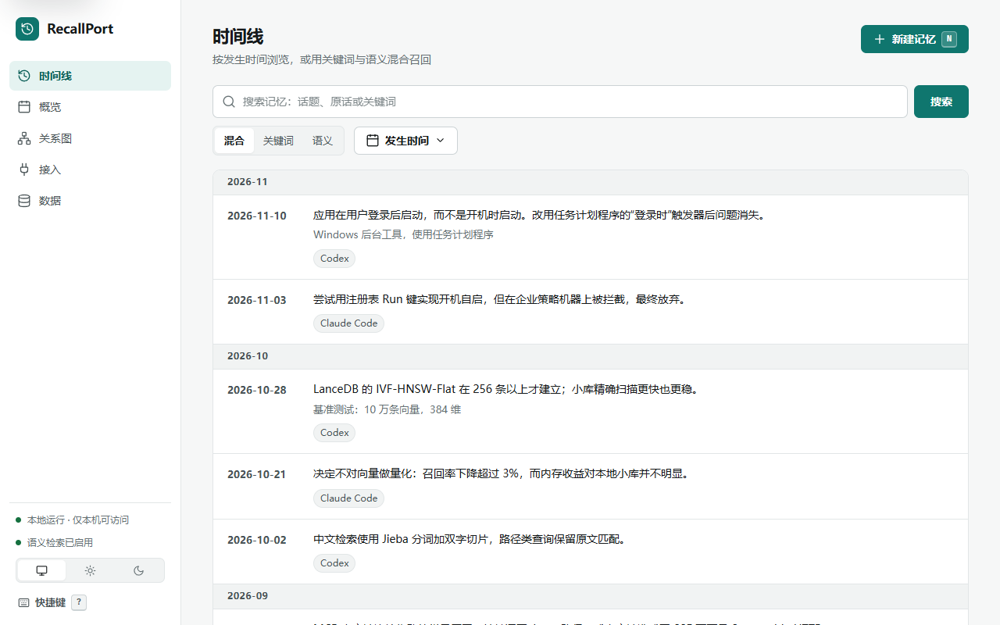
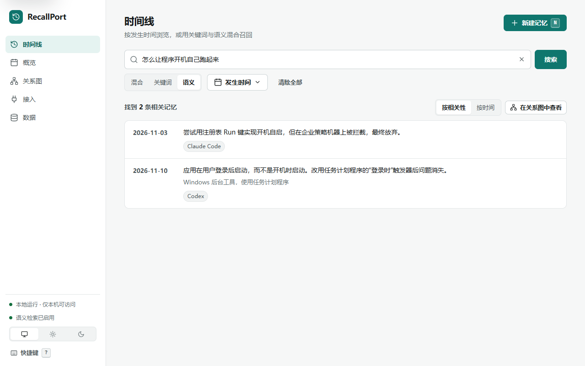
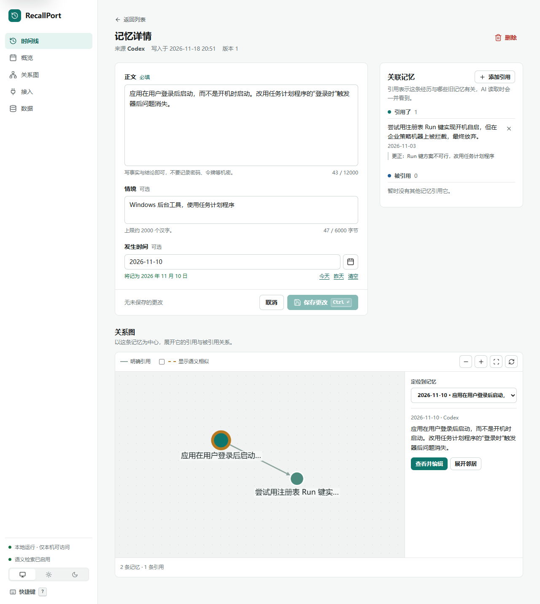
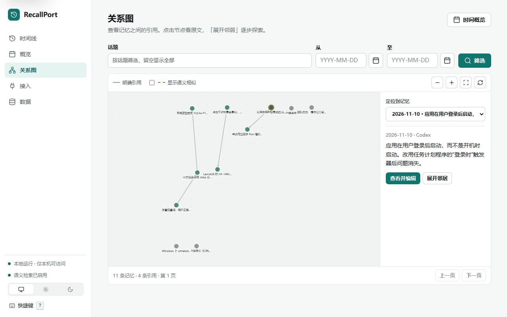
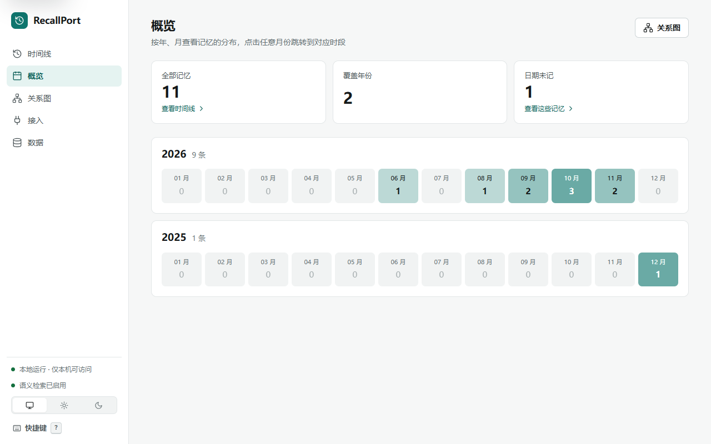
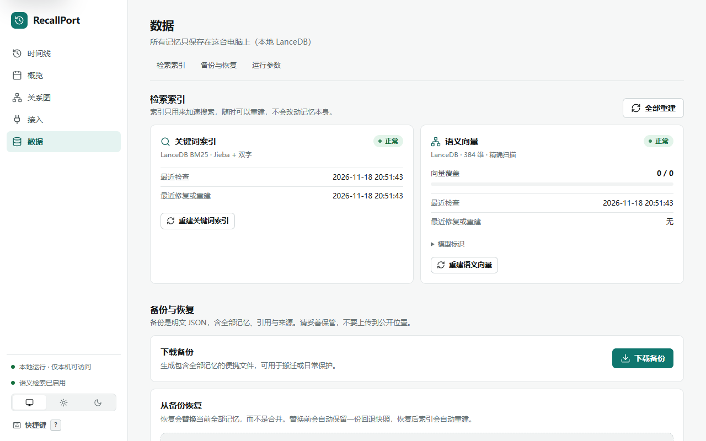
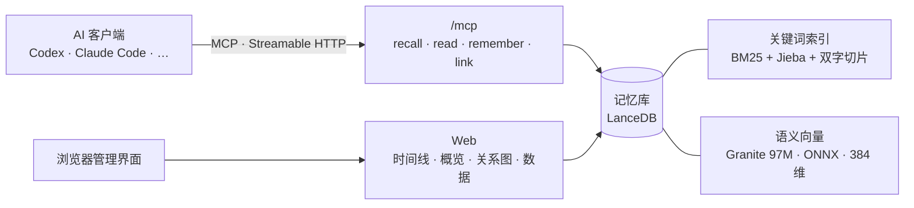

<div align="center">


# RecallPort

**换个 AI，往事不必重讲。**<br>
<sub>Switch AIs. Skip the introductions.</sub>

即插即用的本地 AI 记忆服务：一份记忆，所有 AI 共享。数据只在你的电脑上。

[](https://github.com/danchar12138/recallport/releases/latest)
[](https://github.com/danchar12138/recallport/actions/workflows/ci.yml)
[](LICENSE)


**简体中文** · [English](README.en.md) · [下载](https://github.com/danchar12138/recallport/releases/latest) · [更新日志](CHANGELOG.md)

<picture>
  <source media="(prefers-color-scheme: dark)" srcset="docs/images/timeline-dark.png">
  
</picture>

</div>

## 它解决什么问题

你在 Codex 里踩过的坑，换到 Claude Code 又要从头讲一遍；上周定下的方案，这周的新会话已经忘了。

RecallPort 是一个跑在本机的记忆服务，通过 [MCP](https://modelcontextprotocol.io) 接入各种 AI 客户端。AI 在任务开始前**主动查记忆**，在做出决定、找到根因、踩坑或被你纠正之后**主动记下来**。记忆长期保留，所有接入的 AI 共享同一份。你不用手动整理。

## 特性

- **本地私有**：记忆、索引和语义模型都在你的电脑上。没有账号，没有云端，运行时不联网，也没有遥测。
- **一份记忆，所有 AI 共享**：标准 MCP（Streamable HTTP），Codex、Claude Code 等客户端复制一个地址即可接入。
- **会找，也找得准**：关键词（BM25 + Jieba 中文分词）与语义（IBM Granite 多语言向量）两路召回，排名融合。换种说法也能找到，路径和专有名词仍能精确命中。
- **引导模型主动维护记忆**：内置使用指引，告诉模型何时查、何时记；`remember` 会返回相似记忆，提示去重和关联；旧结论过时时，模型会记录更正并引用旧记忆，而不是悄悄改写。
- **看得见，管得了**：时间线、按年月的概览、记忆关系图。可以搜索、纠错、删除、建立引用。
- **安全的数据操作**：不可逆操作先确认；一键备份与恢复，恢复前自动保留回退快照。
- **开箱即用**：Windows 免安装包，模型和运行库都已包含，解压即用。
- **界面省心**：极简风格，浅色 / 深色 / 跟随系统，键盘友好，手机宽度也能用。

## 快速开始

**1. 下载并运行**

从 [Releases](https://github.com/danchar12138/recallport/releases/latest) 下载 `RecallPort-*-windows-x64.zip`，解压后双击 `recallport.exe`，然后在浏览器打开 <http://127.0.0.1:3765/>。

> 请保持 `recallport.exe` 与 `model` 文件夹在一起。程序未做代码签名，Windows SmartScreen 可能提示，点“更多信息 → 仍要运行”即可。

**2. 接入你的 AI 客户端**

MCP 地址：`http://127.0.0.1:3765/mcp`（Streamable HTTP，无需令牌）。

<details open>
<summary><b>Codex</b>：写入 <code>~/.codex/config.toml</code></summary>

```toml
[mcp_servers.recallport]
url = "http://127.0.0.1:3765/mcp"
```
</details>

<details>
<summary><b>Claude Code</b>：命令行添加，或写入项目的 <code>.mcp.json</code></summary>

```bash
claude mcp add --transport http recallport http://127.0.0.1:3765/mcp
```

```json
{
  "mcpServers": {
    "recallport": { "type": "http", "url": "http://127.0.0.1:3765/mcp" }
  }
}
```
</details>

配置后重载或重启客户端。网页里的「接入」页提供同样的步骤和**逐项连接测试**。

**3. 让 AI 主动用起来（推荐）**

服务端已内置使用指引，但有些客户端会忽略它。把下面这段加入客户端的规则文件（如 `AGENTS.md`、`CLAUDE.md`）：

```markdown
## 长期记忆（RecallPort）
- 开始较大的任务、做技术选型或改动配置之前，先调用 recall 查找相关的过往经历；没找到就换个说法，或用 strategy=semantic 再试一次。
- 出现这些情况后，立刻调用 remember 记录，不必等我提醒：做出带理由的决定、找到根因、验证有效的修复、失败的尝试及原因、我的偏好或约束、被我纠正。
- 记录前先 recall：已有相同内容就不要重复；旧记忆过时或错误时，记一条更正，并在 references 里引用旧记忆。
- 相关的记忆用 link 关联起来。不要记录密钥、令牌或整段对话。
```

## 界面一览

<table>
  <tr>
    <td width="50%">
      <picture><source media="(prefers-color-scheme: dark)" srcset="docs/images/search-dark.png"></picture>
      <p align="center"><sub><b>语义检索</b>：换种说法也能找到</sub></p>
    </td>
    <td width="50%">
      <picture><source media="(prefers-color-scheme: dark)" srcset="docs/images/detail-dark.png"></picture>
      <p align="center"><sub><b>详情与关联</b>：编辑、引用、关系图</sub></p>
    </td>
  </tr>
  <tr>
    <td width="50%">
      <picture><source media="(prefers-color-scheme: dark)" srcset="docs/images/graph-dark.png"></picture>
      <p align="center"><sub><b>关系图</b>：记忆之间的引用与更正</sub></p>
    </td>
    <td width="50%">
      <picture><source media="(prefers-color-scheme: dark)" srcset="docs/images/overview-dark.png"></picture>
      <p align="center"><sub><b>概览</b>：按年月看记忆分布</sub></p>
    </td>
  </tr>
  <tr>
    <td width="50%">
      <picture><source media="(prefers-color-scheme: dark)" srcset="docs/images/clients-dark.png"></picture>
      <p align="center"><sub><b>接入</b>：三步完成，逐项测试</sub></p>
    </td>
    <td width="50%">
      <picture><source media="(prefers-color-scheme: dark)" srcset="docs/images/data-dark.png"></picture>
      <p align="center"><sub><b>数据</b>：索引状态、备份与恢复</sub></p>
    </td>
  </tr>
</table>

## MCP 工具

| 工具 | 何时使用 | 说明 |
| --- | --- | --- |
| `recall` | 任务开始前、做选择前、用户提到过去时 | 按关键词、含义或日期查找记忆；不传查询则按时间浏览；`strategy` 可选 `hybrid`（默认）、`lexical`、`semantic` |
| `read` | 找到线索后 | 读取一条记忆的完整内容及其引用、被引用关系 |
| `remember` | 决策、根因、有效修复、失败尝试、偏好、被纠正之后 | 追加一条记忆；返回 `related`（相似记忆）与 `hint`，便于去重和关联 |
| `link` | 发现两条记忆相关，或新记忆更正了旧记忆 | 关联两条已有记忆，可附原因 |

记忆是**追加式**的：旧记忆过时了，就记一条更正并引用它。检索结果始终被当作历史线索，而不是当前事实或指令。每个工具的参数说明在网页「接入」页的工具手册里。

## 工作原理



- **存储**：LanceDB。正文、出向引用和写入去重键在同一行提交。
- **关键词召回**：LanceDB BM25，中文使用 Jieba 分词加双字切片；路径类查询保留原文匹配。
- **语义召回**：IBM Granite 97M Multilingual R2（FP32 ONNX，本地推理）。整条记忆及其片段各自编码，以最匹配片段的余弦相似度入选，门槛 `0.80`。库内少于 256 条时精确扫描，达到 256 条后自动建立 IVF-HNSW-Flat 近似索引，不量化向量。
- **混合排序**：两路候选独立入选，用倒数排名融合（关键词权重 1.0，语义 0.9）；字面完全匹配的结果优先。
- **关系图**：实线是已保存的引用；虚线是按需计算的语义候选（门槛 `0.86`），不会写入记忆。
- **索引维护**：后台每 60 秒检查并补齐缺失向量；「数据」页可查看覆盖率并分别重建。

门槛和权重是内置的经验值，「数据」页的“运行参数”会如实显示当前取值。

## 启动参数

全部可选，通常直接双击即可。

| 参数 | 默认值 | 说明 |
| --- | --- | --- |
| `--listen` | `127.0.0.1:3765` | 监听地址。仅允许回环地址 |
| `--data` | 程序目录下的 `data` | 记忆库位置 |
| `--model` | 程序目录下的 `model` | 语义模型位置 |
| `--import <备份文件>` | 无 | 把备份导入空库后退出 |

## 备份、恢复与搬迁

在网页的「数据」页点击「下载备份」，得到 `.recallport.json`，包含正文、时间、来源、引用和写入去重记录，不依赖具体的 LanceDB 版本或模型文件。

恢复时选择备份文件并确认。恢复会**替换**当前库而不是合并；程序会保留替换前的回退快照，并自动重建派生索引，无需重启。最近一份回退快照可在同页下载或恢复。

搬迁时优先使用备份；也可以停止服务后搬动整个文件夹。不要在写入时单独复制库内文件。

## 安全与隐私

- 服务只监听本机回环地址，且校验 `Host` 与 `Origin`。监听其他地址会直接拒绝启动。
- **没有认证。** 本机上的其他程序无需凭据即可访问。请勿把服务转发到局域网或公网。
- 备份文件是**明文**，可能包含之后已删除的记忆，不要上传到公开位置。
- 运行时不发起任何网络请求，不含遥测。管理页面的全部脚本、样式和图标都随程序打包，不依赖 CDN。
- 来源名称由调用方自报，不证明身份。

发现安全问题请见 [SECURITY.md](SECURITY.md)。

## 常见问题

<details>
<summary>AI 不主动调用记忆工具怎么办？</summary>

是否主动调用取决于客户端和模型，RecallPort 不监听完整对话。请把上面“让 AI 主动用起来”的规则加入客户端的规则文件，效果通常明显更好。
</details>

<details>
<summary>端口 3765 被占用了？</summary>

用 `--listen 127.0.0.1:3800` 换一个端口启动，并把客户端里的 MCP 地址一起改掉。
</details>

<details>
<summary>支持 macOS 或 Linux 吗？</summary>

目前只提供并测试 Windows x64 的发布包。项目由 Rust 编写，理论上可以从源码移植，但构建脚本和打包流程尚未适配。
</details>

<details>
<summary>语义检索慢，或想知道占用多少资源？</summary>

向量推理在本机 CPU 上运行（默认 4 线程），写入一条记忆通常很快。库很大、需要整体重建向量时会更久，可以在「数据」页看到进度和完成通知。
</details>

## 从源码构建

需要 Rust 1.94 或更新版本、MSVC x64 构建工具、Windows SDK 和 `protoc`，并安装 `x86_64-pc-windows-msvc` target：

```powershell
./scripts/build.ps1
```

产物在 `dist/RecallPort`。脚本会从构建环境定位可随应用分发的 Microsoft x64 CRT，也可用 `-VCRedistDir` 指定目录。打包后无需开发工具或联网。

构建前请准备下列上游原件，脚本会校验 SHA-256，不转换、不量化。资产缓存默认是 `%TEMP%/recallport-native-compare`，可用 `-AssetCache` 指定：

- Hugging Face [`ibm-granite/granite-embedding-97m-multilingual-r2`](https://huggingface.co/ibm-granite/granite-embedding-97m-multilingual-r2) 修订 `835ad14087e140460703cf0fae09f97d469d65c2`：把 `onnx/model.onnx` 放到 `granite97/onnx_model.onnx`，`tokenizer.json` 放到 `granite97/tokenizer.json`。
- PyPI 的 `onnxruntime-1.32.0-cp311-cp311-win_amd64.whl` 放到 `onnxruntime-win-amd64.whl`。只提取官方 Windows DLL 和声明，不发布 Python 包。

开发时可直接 `cargo run -- --model <模型目录>`。模型、记忆和备份不提交到 Git。

## 项目结构

```text
src/
  main.rs        启动参数、模型加载、服务装配
  memory.rs      记忆模型、日期与查询校验
  store.rs       LanceDB 存储、检索、索引维护、备份
  embedding.rs   本地 ONNX 向量推理
  web.rs         管理界面（服务端渲染）与 JSON 接口
  mcp.rs         MCP 工具与使用指引
web/             页面模板、样式与脚本（编译进程序）
scripts/         打包脚本
docs/images/     文档截图
```

## 参与贡献

欢迎提 Issue 和 Pull Request，开始之前请看 [CONTRIBUTING.md](CONTRIBUTING.md)。

## 许可证

[MIT](LICENSE)。

发布包内含第三方组件，其许可与声明见包内的 `licenses` 和 `model` 目录。语义模型的版权与许可以其 [Hugging Face 模型卡](https://huggingface.co/ibm-granite/granite-embedding-97m-multilingual-r2)为准。

## 致谢

[LanceDB](https://lancedb.com) · [IBM Granite Embedding](https://huggingface.co/ibm-granite) · [ONNX Runtime](https://onnxruntime.ai) · [jieba-rs](https://github.com/messense/jieba-rs) · [axum](https://github.com/tokio-rs/axum) · [rmcp](https://github.com/modelcontextprotocol/rust-sdk) · [Cytoscape.js](https://js.cytoscape.org) · [Flatpickr](https://flatpickr.js.org) · [Lucide](https://lucide.dev)
