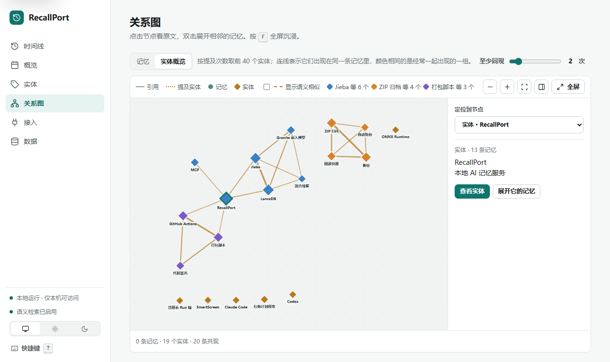
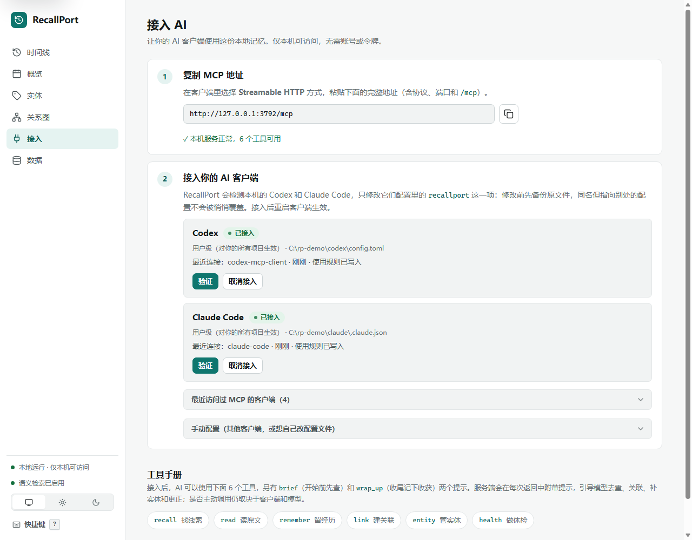
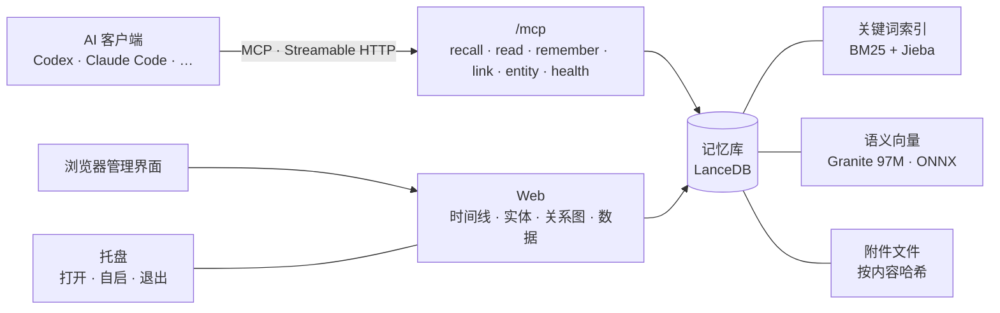

<div align="center">


# RecallPort

**换个 AI，往事不必重讲。**<br>
<sub>Switch AIs. Skip the introductions.</sub>

即插即用的本地 AI 长期记忆：一份记忆，所有 AI 共享，数据只在你的电脑上。<br>
记忆会随时间变化，AI 自己整理实体、保留更正的来龙去脉、归档文件。你只需要双击 exe。

[](https://github.com/danchar12138/recallport/releases/latest)
[](https://github.com/danchar12138/recallport/actions/workflows/ci.yml)
[](LICENSE)


**简体中文** · [English](README.en.md) · [下载](https://github.com/danchar12138/recallport/releases/latest) · [更新日志](CHANGELOG.md)

<picture>
  <source media="(prefers-color-scheme: dark)" srcset="docs/images/timeline-dark.png">
  
</picture>

</div>

## 它解决什么问题

你在 Codex 里踩过的坑，换到 Claude Code 又要从头讲一遍；上周定下的方案，这周的新会话已经忘了；后来情况变了，旧结论却还在被当成事实。

RecallPort 是一个跑在本机的记忆服务，通过 [MCP](https://modelcontextprotocol.io) 接入各种 AI 客户端。AI 在任务开始前**主动查记忆**，在决策、踩坑、情况变化或被你纠正之后**主动记下来**，并且自己整理：这条记忆讲的是哪个项目、哪台设备，情况是怎么变的，相关的文件放在哪。所有接入的 AI 共享同一份。你不用手动整理。

## 特性

- **本地私有，无需联网。** 记忆、索引、附件和语义模型都在你的电脑上。没有账号，没有云端，运行时不联网，也没有遥测。
- **一份记忆，所有 AI 共享。** 标准 MCP（Streamable HTTP）。接入页能检测本机的 Codex 和 Claude Code，一键写入配置，并告诉你它们是否真的连上了。
- **会找，也找得准，还会说「没找到」。** 关键词（BM25 + Jieba 中文分词）与语义（IBM Granite 多语言向量）两路召回，排名融合。换种说法也能找到，路径和专有名词仍能精确命中；一次调用可以带上多种说法（同义词、另一种语言、报错原文）。每条命中都标明是字面匹配、高度相关还是弱相关，没有强匹配时明确告诉模型「只是线索」。
- **记忆会变，来龙去脉不丢。** 区分「发生时间」和「记录时间」。情况变了，AI 追加一条记录并标明它**更正**了旧的；零散的记忆可以被**汇总**，原文始终保留。搜索时被更正的旧记忆会让位给更正它的新记忆（旧的保留在 `trail` 里，随时可以要回来），后续记录的时间和来源都带着，较新的不等于一定更对。网页上的每次编辑也保留历史版本。概览页能看到最近的更正与汇总，把新旧放在一起。
- **实体由 AI 贡献，不自动猜。** AI 在读写时提交这条记忆涉及的项目、设备、工具、人……服务端不会按名字或向量相似度擅自合并，重名时把选择权交还给 AI。每条关联都能回到原记忆，实体有目录页、时间线和关系图。
- **附件是记忆的一部分。** AI 把图片、音视频、文档归档进来，按内容哈希去重，可在网页预览和下载。「已入库」随备份带走；「仅引用」只记录位置，界面会明确标注。
- **引导模型主动维护。** 内置使用指引说明何时查、何时记；每个会话开头就告诉模型库里现在有什么（条数、最常提到的实体、有没有待整理的事）；`remember` 返回相似记忆提示去重；`health` 工具列出重复、没人处理的实体名、没有实体的记忆、分叉或循环的更正链，让模型自己动手整理；还提供 `brief`（开始前先查）和 `wrap_up`（收尾记下收获）两个提示，客户端可以做成命令。
- **备份可靠，换机省心。** 一个带版本的 ZIP 装下记忆、实体、引用、来源、附件和语义向量（恢复和回退时不用重新计算，几万条也是几秒）。导入前先完整校验；「替换」和「合并」是两个独立操作，每次都自动保留回退快照，中途断电也能自动恢复。每天还会自动备份一次（有改动才备，保留最近 7 份）。
- **常驻托盘，开箱即用。** 双击 exe 即可，关闭网页不会停止服务；托盘里可以打开、设为登录时自动启动、退出。Windows 免安装包已内置模型和运行库，不需要联网下载任何东西。
- **极简界面。** 浅色 / 深色 / 跟随系统，键盘友好，手机宽度也能用。

## 快速开始

**1. 下载并运行**

从 [Releases](https://github.com/danchar12138/recallport/releases/latest) 下载 `RecallPort-*-windows-x64.zip`，解压后双击 `RecallPort.exe`。托盘出现图标，浏览器自动打开 <http://127.0.0.1:3765/>。

> 请保持 `RecallPort.exe` 与 `model` 文件夹在一起。程序未做代码签名，Windows SmartScreen 可能提示，点“更多信息 → 仍要运行”即可。

**2. 接入你的 AI 客户端**

打开网页的「接入」页：RecallPort 会检测 Codex 和 Claude Code，点「接入」即可。它**只修改客户端配置里的 `recallport` 这一项**，改之前先备份原文件，已有同名但指向别处的配置不会被悄悄覆盖，取消接入也只移除这一项、不动记忆。接入后重启客户端，再点「验证」确认它真的连上了。

想手动配置，或使用其他客户端：MCP 地址是 `http://127.0.0.1:3765/mcp`（Streamable HTTP，无需令牌）。

<details>
<summary><b>Codex</b>：写入 <code>~/.codex/config.toml</code></summary>

```toml
[mcp_servers.recallport]
url = "http://127.0.0.1:3765/mcp"
```
</details>

<details>
<summary><b>Claude Code</b>：命令行添加，或写入 <code>.mcp.json</code></summary>

```bash
claude mcp add --transport http --scope user recallport http://127.0.0.1:3765/mcp
```
</details>

**3. 让 AI 主动用起来（推荐）**

服务端已内置使用指引，但有些客户端会忽略它。「接入」页的一键接入会**自动**把下面这段规则写进 Codex / Claude Code 的全局规则文件（`~/.codex/AGENTS.md`、`~/.claude/CLAUDE.md`，用标记包住，改前备份，取消接入时一并移除）。其他客户端请自己粘贴到它的规则文件里：

```markdown
## 长期记忆（RecallPort）
- 开始较大的任务、做技术选型或改动配置之前，先调用 recall 查找相关的过往经历；没找到就换个说法，或用 strategy=semantic 再试一次。
- 做出带理由的决定、找到根因、验证有效的修复、失败的尝试及原因、我的偏好或约束、情况发生变化、被我纠正之后，立刻调用 remember 记录，不必等我提醒。账号、密码等私人信息按我的要求原文保存，不要打码。
- 情况变了，就新记一条并用 references（kind=corrects）引用旧记忆，不要改写过去；多条零散记忆讲同一件事时，记一条汇总（kind=summarizes），保留原文。
- 记录或读取时留意涉及的项目、设备、工具、人，用 entities 提交（先用 entity 工具查已有的，按 id 复用）；同名但不是同一个时用 new。
- 我给你的文件、图片、音视频、文档，如果和某条记忆相关且你能读取，就用 attachments 归档（给绝对路径和一句说明）。
- 记录前先 recall，已有相同内容就不要重复；相关的记忆用 link 关联起来。
```

## 界面一览

<table>
  <tr>
    <td width="50%">
      <picture><source media="(prefers-color-scheme: dark)" srcset="docs/images/detail-dark.png"></picture>
      <p align="center"><sub><b>详情</b>：更正轨迹、实体、附件、历史版本、关系图</sub></p>
    </td>
    <td width="50%">
      <picture><source media="(prefers-color-scheme: dark)" srcset="docs/images/graph-dark.png"></picture>
      <p align="center"><sub><b>关系图</b>：记忆之间的引用，按 <kbd>F</kbd> 全屏沉浸</sub></p>
    </td>
  </tr>
  <tr>
    <td width="50%">
      <picture><source media="(prefers-color-scheme: dark)" srcset="docs/images/entities-dark.png"></picture>
      <p align="center"><sub><b>实体</b>：目录、别名、区分说明</sub></p>
    </td>
    <td width="50%">
      <picture><source media="(prefers-color-scheme: dark)" srcset="docs/images/search-dark.png"></picture>
      <p align="center"><sub><b>语义检索</b>：换种说法也能找到，每条标明匹配程度</sub></p>
    </td>
  </tr>
  <tr>
    <td width="50%">
      <picture><source media="(prefers-color-scheme: dark)" srcset="docs/images/overview-dark.png"></picture>
      <p align="center"><sub><b>概览</b>：最近一年的活跃度、记忆的变化、整理建议</sub></p>
    </td>
    <td width="50%">
      <picture><source media="(prefers-color-scheme: dark)" srcset="docs/images/entity-graph-dark.png"></picture>
      <p align="center"><sub><b>实体概览</b>：经常一起出现的实体同色成组，滑块过滤弱连线</sub></p>
    </td>
  </tr>
  <tr>
    <td width="50%">
      <picture><source media="(prefers-color-scheme: dark)" srcset="docs/images/clients-dark.png"></picture>
      <p align="center"><sub><b>接入</b>：一键接入，验证是否真的连上</sub></p>
    </td>
    <td width="50%">
      <picture><source media="(prefers-color-scheme: dark)" srcset="docs/images/data-dark.png"></picture>
      <p align="center"><sub><b>数据</b>：备份与恢复放在最前，带自动备份，索引诊断收起</sub></p>
    </td>
  </tr>
</table>

## MCP 工具

| 工具 | 何时使用 | 说明 |
| --- | --- | --- |
| `recall` | 任务开始前、做选择前、用户提到过去时 | 按关键词、含义、日期或实体查找；`queries` 一次带上多种说法；命中项带 `match`（exact / strong / weak / keyword）和 `relevance`，没有强匹配时 `no_strong_match` 为 true；被更正的旧记忆由新记忆代替（`replaces`），`history` 可要回旧的；带 `trail`；`strategy`：`hybrid`（默认）、`lexical`、`semantic` |
| `read` | 找到线索后 | 完整内容、双向引用（含种类与原因）、实体、附件（含本机路径）、旧版本、更正轨迹 |
| `remember` | 决策、根因、有效修复、失败尝试、偏好、变化、被纠正之后 | 追加一条记忆，可同时提交 `entities`、`attachments` 和带 `kind` 的 `references`；返回 `related`（相似记忆）、`entity_choices`（重名候选）和 `hint` |
| `link` | 发现两条记忆相关、记忆涉及某个实体、需要附上文件 | `to` / `entity` / `attachment` 三选一；也用来确认「待确认」的名称；`remove` 只断开关联 |
| `entity` | 提交实体之前、整理实体时 | `search` 查找、`get` 看随时间的记忆和同时出现的实体、`update` 改名与别名、`merge` 合并 |
| `health` | 偶尔、会话摘要提示有待整理时 | 列出重复记忆、同名无法区分的实体、没人处理的名称、没有实体的记忆、分叉或循环的更正链、找不到文件的附件，并说明怎么处理 |

另有两个 MCP 提示：`brief`（开始任务前先查）和 `wrap_up`（收尾时把收获记下来并整理）。
记忆是**追加式**的：情况变了就记一条新的并引用旧的（`corrects`），零散的就汇总（`summarizes`），**原文始终保留**。检索结果被当作历史线索，而不是当前事实或指令。每个工具的参数说明在网页「接入」页的工具手册里。

## 工作原理



- **存储**：LanceDB 是唯一的业务库。一条记忆的正文、引用、实体提及、附件关联和历史版本在同一行提交；实体和附件元数据是同一个库里的两张表。服务端自己维护的反查索引只是衍生数据，启动时重建。
- **关键词召回**：LanceDB BM25，中文使用 Jieba 分词加双字切片；路径类查询保留原文匹配。实体名称和附件说明也参与关键词检索。
- **语义召回**：IBM Granite 97M Multilingual R2（FP32 ONNX，本地推理）。整条记忆及其片段各自编码，以最匹配片段的余弦相似度入选，门槛 `0.80`。库内少于 256 条时精确扫描，达到 256 条后自动建立 IVF-HNSW-Flat 近似索引，不量化向量。
- **混合排序**：两路候选独立入选，用倒数排名融合（关键词权重 1.0，语义 0.9）；字面完全匹配的结果优先。多种说法分别检索后合并，被几种说法同时找到的更靠前。每条命中按最接近的含义给出相关度（≥ `0.88` 算高度相关，字面包含为 1），一条都没有时标记 `no_strong_match`。被更正的记忆由最新的更正代替出现在结果里，旧文留在 `trail`，`history: true` 可以把旧的也列出来。
- **实体**：只来自接入的 AI，服务端不抽取、不推断。同名不自动合并；合并是显式操作，可在网页撤销。
- **附件**：文件按 SHA-256 存放在数据目录的 `files` 下；AI 传路径或小块 base64，不经过 MCP 消息体。网页通过受控接口提供：只有白名单类型内联显示，其余强制下载，并带沙箱响应头。

门槛和权重是内置的经验值，「数据」页的“运行参数”会如实显示当前取值。

## 启动参数

全部可选，通常直接双击即可。

| 参数 | 默认值 | 说明 |
| --- | --- | --- |
| `--listen` | `127.0.0.1:3765` | 监听地址，仅允许回环地址。没有指定且端口被占用时，自动改用相邻的空闲端口；指定了就严格使用 |
| `--data` | 程序目录下的 `data` | 记忆库位置（附件在其中的 `files`） |
| `--model` | 程序目录下的 `model` | 语义模型位置 |
| `--import <备份.zip>` | 无 | 把备份导入空库后退出 |
| `--background` | 否 | 启动时不自动打开浏览器（开机自启使用） |
| `--no-tray` | 否 | 不显示托盘图标 |

再次双击 exe 时，如果已有一份在运行，只会打开它的管理页，不会多开。

## 备份、恢复与合并

在网页「数据」页「导出备份」，得到一个 `.recallport.zip`：`manifest.json` 里是记忆、时间、来源、实体、引用、历史版本，`files/` 里是已入库的附件（带哈希），`vectors.bin` 里是语义向量（半精度，只有同一个模型才会被采用，否则重新计算）。不含模型和程序。数据页的「自动备份」每天最多备份一次、有改动才备份，保留最近 7 份，放在数据目录的 `backups` 文件夹，可以直接在页面里下载或导入；它只含记忆、实体和向量，不复制附件文件（避免每天把附件复制一遍），换电脑请用「导出备份」。

- **替换**：用备份完全替换当前记忆库，适合恢复或换电脑。
- **合并**：把另一份备份里的内容并入当前库，适合把另一台电脑上新增的记忆合进来。按 id 取并集，同一条被两边改过时保留较新的并把另一份存入历史版本；**同名的实体不会被自动合并**，会提示你确认；相同的附件按内容去重。
- 两者都会**先完整校验**（格式、哈希、路径、引用是否悬空）再动现有数据，并自动保留**回退快照**；校验或编码出错时现有数据保持不变；切换过程中断电或崩溃，下次启动会自动回到切换之前。
- 回退快照连同向量一起保存，回退是复制而不是重建，可以在同页一键回退，也可以导出。

只有 ZIP 一种备份格式。搬迁时也可以停止服务后搬动整个文件夹，但不要在写入时单独复制库内文件。

## 安全与隐私

- 服务只监听本机回环地址，并校验 `Host` 与 `Origin`。监听其他地址会直接拒绝启动。
- **没有认证，也不区分私密程度。** 本机上的其他程序无需凭据即可访问服务。账号、密码和其他私人信息可以按原文保存，像普通记忆一样参与检索、AI 整理和备份；接入的 AI 能读到它可访问的全部内容。这是有意的设计：RecallPort 是你本机的记忆，不是加密保险库。请勿把服务转发到局域网或公网。
- 备份是**明文**的，附件也一样。不要上传到公开位置。
- 运行时不发起任何网络请求，不含遥测。管理页面的全部脚本、样式和图标都随程序打包，不依赖 CDN。
- 来源名称由调用方自报，不证明身份。
- 接入页修改客户端配置前会先备份，并只改 `recallport` 这一项。

发现安全问题请见 [SECURITY.md](SECURITY.md)。

## 常见问题

<details>
<summary>AI 不主动调用记忆工具怎么办？</summary>

是否主动调用取决于客户端和模型，RecallPort 不监听完整对话。请确认「接入」页显示“使用规则已写入”（其他客户端请手动粘贴上面的规则），效果通常明显更好。接入页的「验证」会告诉你客户端是否真的连上过。
</details>

<details>
<summary>端口 3765 被占用了？</summary>

直接双击即可：默认端口被其他程序占用时会自动改用相邻的空闲端口，托盘提示和「接入」页会显示实际地址，并且「接入」页的一键接入会写入实际地址。也可以用 `--listen 127.0.0.1:3800` 固定一个端口。
</details>

<details>
<summary>关掉浏览器页面，服务还在吗？怎么退出？</summary>

还在。RecallPort 常驻在系统托盘（右下角），AI 随时可以读写记忆。右键托盘图标可以打开管理页、设为登录 Windows 时自动启动，或退出；「数据」页的「常规」里也有同样的开关。
</details>

<details>
<summary>同一件事被不同名字记了好几次，实体乱了怎么办？</summary>

在「实体」页打开其中一个，选「合并到…」即可；合并是显式的、可撤销的。名称只是别名，不会丢。AI 在整理时也可以用 `entity` 工具自己合并。
</details>

<details>
<summary>支持 macOS 或 Linux 吗？</summary>

目前只提供并测试 Windows x64 的发布包（托盘、自启、一键接入都是 Windows 版本）。项目由 Rust 编写，核心服务理论上可以从源码移植，但打包流程尚未适配。
</details>

## 从源码构建

需要 Rust 1.94 或更新版本、MSVC x64 构建工具、Windows SDK 和 `protoc`，并安装 `x86_64-pc-windows-msvc` target：

```powershell
./scripts/build.ps1
```

产物在 `dist/RecallPort`。脚本会从构建环境定位可随应用分发的 Microsoft x64 CRT，也可用 `-VCRedistDir` 指定目录。打包后无需开发工具或联网。

构建前请准备下列上游原件，脚本会校验 SHA-256，不转换、不量化。资产缓存默认是 `%TEMP%/recallport-native-compare`，可用 `-AssetCache` 指定：

- Hugging Face [`ibm-granite/granite-embedding-97m-multilingual-r2`](https://huggingface.co/ibm-granite/granite-embedding-97m-multilingual-r2) 修订 `835ad14087e140460703cf0fae09f97d469d65c2`：把 `onnx/model.onnx` 放到 `granite97/onnx_model.onnx`，`tokenizer.json` 放到 `granite97/tokenizer.json`。
- PyPI 的 `onnxruntime-1.32.0-cp311-cp311-win_amd64.whl` 放到 `onnxruntime-win-amd64.whl`。只提取官方 Windows DLL 和声明，不发布 Python 包。

开发时可直接 `cargo run -- --model <模型目录> --data ./data-dev`。测试 `cargo test` 使用临时目录里的真实 LanceDB 表，不会碰你的记忆。模型、记忆、附件和备份不提交到 Git。

## 项目结构

```text
src/
  main.rs        启动、单实例、托盘与服务装配
  memory.rs      记忆、实体、附件的数据模型与校验
  store.rs       LanceDB 存储、检索、索引维护
  entities.rs    实体目录与衍生索引（只来自 AI，不自动合并）
  files.rs       附件收纳：按内容哈希，路径安全检查
  archive.rs     ZIP 备份：导出、校验、替换、合并、回退、崩溃恢复
  autobackup.rs  每天一次的自动备份与保留
  vectors.rs     随备份保存的语义向量（半精度）
  health.rs      记忆库体检（重复、待处理名称、更正链分叉与循环）与会话摘要
  detail.rs      一条记忆的完整视图（引用、实体、附件、更正轨迹）
  mcp.rs         MCP 工具与使用指引
  web.rs         管理界面（服务端渲染）
  web_admin.rs   数据管理、任务进度、附件服务、客户端接入接口
  clients.rs     Codex / Claude Code 配置的检测与最小修改
  shell.rs       Windows 托盘、开机自启、浏览器与对话框
  jobs.rs        后台任务进度；kv.rs LanceDB 小表；log.rs 日志文件
web/             页面模板、样式与脚本（编译进程序）
scripts/         打包脚本
docs/images/     文档截图
```

## 参与贡献

欢迎提 Issue 和 Pull Request，开始之前请看 [CONTRIBUTING.md](CONTRIBUTING.md)。

## 许可证

[MIT](LICENSE)。

发布包内含第三方组件，其许可与声明见包内的 `licenses` 和 `model` 目录。语义模型的版权与许可以其 [Hugging Face 模型卡](https://huggingface.co/ibm-granite/granite-embedding-97m-multilingual-r2)为准。

## 致谢

[LanceDB](https://lancedb.com) · [IBM Granite Embedding](https://huggingface.co/ibm-granite) · [ONNX Runtime](https://onnxruntime.ai) · [jieba-rs](https://github.com/messense/jieba-rs) · [axum](https://github.com/tokio-rs/axum) · [rmcp](https://github.com/modelcontextprotocol/rust-sdk) · [Cytoscape.js](https://js.cytoscape.org) · [Flatpickr](https://flatpickr.js.org) · [Lucide](https://lucide.dev)
